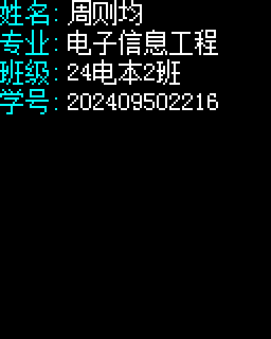

# 实验一：TFT 液晶驱动与字库扩展（竖屏版）

> 平台：STM32F103C8T6 最小系统板 + 1.8 寸 ST7735S SPI TFT（128×160）  
> 开发环境：Keil MDK 5.41 / ARMCC V5.06 update 7，STM32F10x 标准外设库 V3.5.0  
> 连接：软件 SPI（PB5~PB9），无需硬件 SPI 外设  
> 当前方向：**竖屏 128×160**

## 一、实验任务与效果

通过字体取模扩展汉字字库，在 TFT 屏幕上显示姓名、专业、班级、学号：

| 项目 | 显示内容 |
| --- | --- |
| 姓名 | 周则均 |
| 专业 | 电子信息工程 |
| 班级 | 24电本2班 |
| 学号 | 202409502216 |

竖屏宽度只有 128 px。16×16 字号下“专业:电子信息工程”和“学号:202409502216”各需要 136 px，无法在一行内放下，因此竖屏版采用 **12×12 汉字 + 6×12 ASCII**，四项各占一行。排版为**靠左上角、行距 14 px、无边框、无页脚**，原 16×16 字库仍保留在 `font.h` 中，可供横屏或其他实验使用。



> `preview.png` 用工程内实际的 `font.h` 字模和 `main.c` 字符串逐像素模拟生成，与程序在屏幕上的显示内容一致。

### 旋转关系

原横屏使用 `LCD_direction(1)`，现在改为 `LCD_direction(0)`：

- `direction 1`：横屏 160×128；
- `direction 0`：竖屏 128×160，正好是 `direction 1` **逆时针旋转 90°**；
- 如果实物装反、画面上下颠倒，把 `LCD_Init()` 中的 `LCD_direction(0)` 改成 `LCD_direction(2)` 即可。

## 二、硬件连接

| TFT 模块引脚 | STM32F103C8T6 | 说明 |
| --- | --- | --- |
| VCC | 3.3V | 电源正（模块支持 3.3V/5V，逻辑按 3.3V） |
| GND | GND | 电源地 |
| SCL / CLK | PB9 | 软件 SPI 时钟 |
| SDA / MOSI | PB8 | 软件 SPI 数据（只写） |
| RES / RST | PB6 | 复位，低有效 |
| DC / RS | PB7 | 0=命令，1=数据 |
| CS | PB5 | 片选，低有效 |
| BLK / LED | 3.3V | 背光；若模块无此脚则忽略 |

> 若模块背面丝印把 `RS` 写成 `A0`、`SDA` 写成 `MOSI`，按功能对应即可。背光脚（BLK/LED）必须接 3.3V，否则屏幕有内容但无背光，看起来像“白屏/黑屏”。

## 三、工程结构

```text
Exp1_TFT/
├─ CORE/                    CMSIS 内核文件、stm32f10x.h、system_stm32f10x.h
├─ STARTUP/                 startup_stm32f10x_md.s（STM32F103C8 属于 MD 密度）
├─ FWLIB/
│  ├─ inc/                  标准外设库全部头文件
│  └─ src/                  misc.c、stm32f10x_gpio.c、stm32f10x_rcc.c
├─ USER/
│  ├─ Src/main.c            实验主程序（GB2312 编码，竖屏布局）
│  ├─ Src/system_stm32f10x.c
│  ├─ Src/stm32f10x_it.c
│  └─ Include/              stm32f10x_conf.h、stm32f10x_it.h
├─ HARDWARE/
│  ├─ TFT/tft.c、tft.h      ST7735S 软件 SPI 驱动
│  ├─ TFT/font.h            8×16/6×12 ASCII + 16×16/12×12 汉字字库
│  └─ DELAY/delay.c、.h     SysTick 微秒/毫秒延时
├─ PROJECT/Exp1_TFT.uvprojx Keil 工程
├─ Exp1_TFT.hex             已编译好的固件（可直接烧录）
└─ preview.png              竖屏显示效果模拟图
```

## 四、驱动原理

### 4.1 软件 SPI

ST7735S 只支持写，采用 SPI 模式 0（空闲低电平，上升沿采样），MSB 先行：

1. `CS=0`，`RS=0` 表示命令，`RS=1` 表示数据；
2. 每个字节从 bit7 到 bit0：先放 SDA，再给 CLK 一个上升沿；
3. 命令/数据写完后 `CS=1`。

`tft.c` 中用 `GPIOB->BSRR/BRR` 直接操作引脚，72 MHz 下时钟约数 MHz，1.8 寸模块的短线连接可以稳定工作。

### 4.2 初始化与显示方向

`LCD_Init()` 依次完成：

- 使能 GPIOB 时钟，PB5~PB9 配置为 50 MHz 推挽输出；
- 硬件复位（RST 低 50 ms，高 50 ms）；
- 发送 ST7735S 的休眠退出、帧率、电源、Gamma、65K 色、显示开等命令；
- 调用 `LCD_direction(0)` 设置为竖屏 128×160；
- 清屏为黑色。

方向由 `0x36`（MADCTL）寄存器控制。`LCD_direction()` 同时更新 `lcddev.width/height`，后续坐标都以逻辑宽高为准：

| direction | 逻辑尺寸 | 说明 |
| --- | --- | --- |
| 0 | 128×160 | 竖屏（本实验使用，横屏 1 逆时针 90°） |
| 1 | 160×128 | 横屏 |
| 2 | 128×160 | 竖屏 180° |
| 3 | 160×128 | 横屏 180° |

### 4.3 显示窗口与打点

ST7735S 的显存按窗口写入：

- `0x2A` 设置列地址（X 起止）；
- `0x2B` 设置行地址（Y 起止）；
- `0x2C` 开始写 GRAM，之后连续写入的 16 位数据会自动按窗口从左到右、从上到下填充。

`LCD_SetWindows()` 封装了这三条命令；`LCD_Fill()` 在一个窗口内连续写颜色，`LCD_DrawPointColor()` 则把窗口设为 1×1 后写一个像素。清屏、画线、字符、汉字都建立在这两个函数上。

### 4.4 字符与汉字显示

驱动同时支持两种字号：

| 类型 | 字号 | 字模尺寸 | 字库 |
| --- | --- | --- | --- |
| ASCII | 12 | 6×12，每行 1 字节，低位在左 | `asc2_1206[95][12]` |
| ASCII | 16 | 8×16，每行 1 字节，低位在左 | `asc2_1608[95][16]` |
| 汉字 | 12 | 12×12，每行 2 字节，高位在左 | `tfont12[]`，24 字节/字 |
| 汉字 | 16 | 16×16，每行 2 字节，高位在左 | `tfont16[]`，32 字节/字 |

`LCD_ShowChar()` 根据 `size` 选择 6×12 或 8×16 字库；`LCD_ShowChinese()` 根据 `size` 选择 12×12 或 16×16 字库。`LCD_ShowChinese()` 按字节判断：`<0x80` 按 ASCII 画，否则取连续 2 字节 GB2312 内码查表，因此同一个函数可以直接显示“姓名:周则均”这类中英混排字符串。

`LCD_ShowNum()` 也已实现（定宽显示、前导空格），本实验的学号直接用字符串显示，便于保留前导 0。

## 五、字库制作

### 5.1 两套汉字字库

- **12×12**：竖屏 128×160 使用，四项内容各一行；
- **16×16**：保留自横屏版，可通过 `LCD_ShowChinese(..., 16, ...)` 使用。

两套字库都使用相同的 `Index[2]` 结构，仅 `Msk` 长度不同：

```c
typedef struct
{
    unsigned char Index[2];   /* GB2312 内码，2 字节，用于查表 */
    unsigned char Msk[24];    /* 12 行 × 每行 2 字节，高位在左 */
} typFNT_GB12;

typedef struct
{
    unsigned char Index[2];   /* GB2312 内码，2 字节，用于查表 */
    unsigned char Msk[32];    /* 16 行 × 每行 2 字节，高位在左 */
} typFNT_GB16;
```

### 5.2 取模设置

| 字号 | 字体 | 字模选项 | 每行字节 |
| --- | --- | --- | --- |
| 12×12 | 宋体 9 pt（12 px） | **阴码**、**逐行式**、**顺向**、**C51 格式**、十六进制 | 2 字节 |
| 16×16 | 宋体 12 pt（16 px） | **阴码**、**逐行式**、**顺向**、**C51 格式**、十六进制 | 2 字节 |

12×12 汉字共 24 字节：每行 2 字节，每字节只用高 6 位（`bit7~bit2`），左 6 像素在第一个字节、右 6 像素在第二个字节。

> 9 pt 宋体的实际墨迹从 `x=2` 开始、到 `x=12` 结束，共 11 列。取模时按 `x=2..13` 裁切，使左侧贴齐、最右一列不再被截断；每个 12 px 单元右侧保留 1 px 自然边距。

### 5.3 收录的 18 个汉字

| 汉字 | GB2312 | 汉字 | GB2312 | 汉字 | GB2312 |
| --- | --- | --- | --- | --- | --- |
| 姓 | D0D5 | 名 | C3FB | 周 | D6DC |
| 则 | D4F2 | 均 | BEF9 | 专 | D7A8 |
| 业 | D2B5 | 电 | B5E7 | 子 | D7D3 |
| 信 | D0C5 | 息 | CFA2 | 工 | B9A4 |
| 程 | B3CC | 班 | B0E0 | 级 | BCB6 |
| 本 | B1BE | 学 | D1A7 | 号 | BAC5 |

### 5.4 增加新的汉字

1. 用 PCtoLCD2002 按 5.2 的设置对新增汉字取模，得到 24 字节（12×12）或 32 字节（16×16）；
2. 在 `font.h` 对应的 `tfont12[]` 或 `tfont16[]` 末尾增加一项：
   ```c
   {{0xXX,0xXX},
    {0x..,0x..,...}},
   ```
3. `TFONT12_NUM`、`TFONT16_NUM` 用 `sizeof` 自动统计，不需要手工改数量；
4. 在 `main.c` 中调用 `LCD_ShowChinese(x, y, fc, bc, "新字", 12, 0)` 即可（源文件必须保持 GB2312 编码）。

## 六、关键函数

| 函数 | 作用 |
| --- | --- |
| `LCD_Init()` | GPIO、复位、ST7735S 初始化、竖屏、清屏 |
| `LCD_direction(dir)` | 设置显示方向与逻辑宽高（0/2 竖屏，1/3 横屏） |
| `LCD_SetWindows(xs,ys,xe,ye)` | 设置矩形显示窗口 |
| `LCD_DrawPointColor(x,y,c)` | 画一个指定颜色像素 |
| `LCD_Fill(...)` / `LCD_Clear(c)` | 矩形填充 / 全屏清屏 |
| `LCD_DrawLine(...)` / `LCD_DrawRectangle(...)` | 画线 / 画矩形边框 |
| `LCD_ShowChar(...,size,...)` | 显示 6×12 或 8×16 ASCII 字符 |
| `LCD_ShowString(...,size,...)` | 显示 ASCII 字符串 |
| `LCD_ShowNum(...)` | 定宽显示无符号数字 |
| `LCD_ShowChinese(...,size,...)` | 显示中英混排字符串（GB2312 + ASCII，12/16 号） |

## 七、编译与下载

### 7.1 编译

1. 用 Keil MDK5 打开 `PROJECT/Exp1_TFT.uvprojx`；
2. 工程已配置为 `STM32F103C8`、`STM32F10X_MD`、`USE_STDPERIPH_DRIVER`，编译器为 **ARMCC V5.06**；
3. 按 `F7` 编译。

本机实际编译结果：

```text
Build target 'Exp1_TFT'
Program Size: Code=3348 RO-data=4008 RW-data=36 ZI-data=1636
".\Objects\Exp1_TFT.axf" - 0 Error(s), 0 Warning(s).
```

若你的 Keil 只安装了 AC6，可在 `Options for Target → Target → ARM Compiler` 中切换到 `Arm Compiler 6`，代码本身兼容 C99。

### 7.2 下载

- **ST-Link**：SWD 接口接 `SWDIO=PA13`、`SWCLK=PA14`、`GND`、`3.3V`，Keil 中选择 ST-Link Debugger 后下载；
- **串口 ISP**：BOOT0 接 3.3V、BOOT1 接 GND，用 FlyMcu/STM32CubeProgrammer 通过 USART1（PA9/PA10）烧录，再恢复 BOOT0=0 复位；
- **直接烧录**：`Exp1_TFT.hex` 是已经编译好的固件，可直接用上述工具下载。

### 7.3 编码说明（重要）

`USER/Src/main.c` 使用 **GB2312/GBK** 编码保存，因为 Keil 默认按 ANSI（中文 Windows 即 GB2312）读取源文件，这样汉字字面量在编译后正好是 2 字节 GB2312 内码，能与 `font.h` 的索引直接匹配。

- 用 Keil 打开：默认即可正常显示中文；
- 用 VS Code 打开：选择 `Reopen with Encoding → GB18030`，**不要**保存为 UTF-8，否则汉字会变成 3 字节 UTF-8，查表失败、屏幕显示空白；
- 其余 `.c/.h` 文件均为 ASCII/英文注释，不受影响。

## 八、常见问题

| 现象 | 排查方向 |
| --- | --- |
| 竖屏画面上下颠倒 | 把 `LCD_Init()` 中的 `LCD_direction(0)` 改为 `LCD_direction(2)` |
| 想用 16×16 字号 | 竖屏 128 px 宽放不下“专业:电子信息工程”，需要分两行；或改回横屏 160×128 |
| 完全白屏、无背光 | 检查 BLK/LED 是否接 3.3V、VCC/GND、RST 是否接对 |
| 有背光但全白/全黑 | 检查 CS、DC、SDA、SCL 是否接反；用示波器看 PB9 是否有波形；确认 `LCD_Init()` 被调用 |
| 花屏、错位 | 调整 `tft.c` 顶部的 `TFT_X_OFFSET` / `TFT_Y_OFFSET`（常见为 2/1 或 0/0），确认模块是 128×160 |
| 汉字不显示/显示空白 | `main.c` 编码被改成了 UTF-8；或新增汉字没有加入对应的 `tfont12[]` / `tfont16[]` |
| 红蓝颜色互换 | 修改 `LCD_direction()` 中 `0x36` 的 BGR 位（bit3） |
| 颜色整体反相（黑变白） | 在 `LCD_Init()` 的 `0x29` 前加 `LCD_WR_REG(0x21);` 打开反显，或检查模块是否自带反显设置 |

## 九、实验结论

本实验完成了 ST7735S 的软件 SPI 驱动，并把显示从横屏 160×128 逆时针旋转为竖屏 128×160。为了在 128 px 宽度内完整显示四项信息，字库扩展为 12×12 与 16×16 两套汉字字模、6×12 与 8×16 两套 ASCII 字模；通过 `size` 参数在运行时选择字号，实现了姓名、专业、班级、学号的中英混排显示。竖屏内容靠左上角、行距 14 px、无边框和页脚；同时修正了 12×12 取模时最右一列被裁掉的问题。工程在 Keil MDK 5.41 下编译通过（0 error / 0 warning），固件为 3.3 KB Code + 3.9 KB RO-data，远小于 STM32F103C8 的 64 KB Flash。
