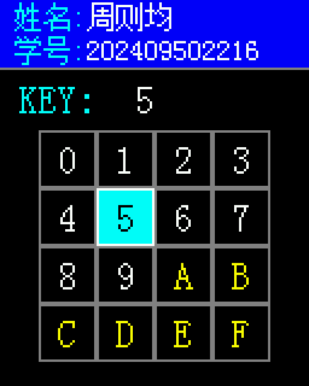

# 实验二：4×4 矩阵键盘驱动

> 平台：STM32F103C8T6 最小系统板 + 1.8 寸 ST7735S SPI TFT（128×160，竖屏）  
> 开发环境：Keil MDK 5.41 / ARMCC V5.06 update 7，STM32F10x 标准外设库 V3.5.0  
> 工程结构：按 Keil 新建工程教程的标准四文件夹（CMSIS / FWLIB / STARTUP / USER），工程文件放在 `USER` 下

## 一、实验任务与效果

1. TFT 屏顶部**固定显示姓名和学号**；
2. 扫描 4×4 矩阵键盘，把键值显示在 TFT 上，16 个按键依次对应 `0,1,2,3,4,5,6,7,8,9,A,B,C,D,E,F`。

界面分三部分：

- **顶部蓝色标题栏**：第一行“姓名:周则均”，第二行“学号:202409502216”，上电后固定不变；
- **键值状态行**：显示 `KEY: X`，X 为最近一次按下的键值；
- **4×4 键值网格**：16 个格子从左到右、从上到下依次是 `0~F`，按下的键用青色高亮，数字 0~9 为白色，A~F 为黄色。

下图为按下 `5` 号键时的屏幕效果（用工程内实际字模逐像素模拟，布局与程序一致）：



## 二、硬件连接

### 2.1 TFT（与实验一相同）

| TFT 模块引脚 | STM32F103C8T6 | 说明 |
| --- | --- | --- |
| VCC | 3.3V | 电源正 |
| GND | GND | 电源地 |
| SCL / CLK | PB9 | 软件 SPI 时钟 |
| SDA / MOSI | PB8 | 软件 SPI 数据 |
| RES / RST | PB6 | 复位，低有效 |
| DC / RS | PB7 | 0=命令，1=数据 |
| CS | PB5 | 片选，低有效 |
| BLK / LED | 3.3V | 背光 |

### 2.2 4×4 矩阵键盘

| 键盘线 | STM32F103C8T6 | 方向 | 配置 |
| --- | --- | --- | --- |
| KEY8 | PA7 | 行 0 | 推挽输出 |
| KEY7 | PA6 | 行 1 | 推挽输出 |
| KEY6 | PA5 | 行 2 | 推挽输出 |
| KEY5 | PA4 | 行 3 | 推挽输出 |
| KEY4 | PB11 | 列 0 | 上拉输入 |
| KEY3 | PB10 | 列 1 | 上拉输入 |
| KEY2 | PB1 | 列 2 | 上拉输入 |
| KEY1 | PB0 | 列 3 | 上拉输入 |

> TFT 占用 PB5~PB9，键盘占用 PB0、PB1、PB10、PB11，**没有引脚冲突**；PA4~PA7 也不是 JTAG 引脚，可直接使用。

## 三、工程结构

```text
Exp2_Keypad/
├─ CMSIS/                       CMSIS 内核与系统文件
│  ├─ core_cm3.c/.h
│  ├─ stm32f10x.h
│  └─ system_stm32f10x.c/.h
├─ FWLIB/                       STM32F10x 标准外设库 V3.5.0
│  ├─ inc/                      全部外设头文件
│  └─ src/                      全部外设源文件
├─ STARTUP/
│  └─ startup_stm32f10x_md.s    STM32F103C8 属于中密度（MD）
├─ HARDWARE/                    板级驱动
│  ├─ TFT/ tft.c、tft.h、font.h ST7735S 软件 SPI 驱动与字库
│  ├─ DELAY/ delay.c、delay.h   SysTick 微秒/毫秒延时
│  └─ KEY/ key.c、key.h         4×4 矩阵键盘驱动
├─ USER/
│  ├─ Src/main.c                实验主程序（GB2312 编码）
│  ├─ Src/stm32f10x_it.c        中断服务函数
│  ├─ Include/                  stm32f10x_conf.h、stm32f10x_it.h
│  ├─ Objects/                  Keil 编译输出（自动生成）
│  ├─ Listings/                 Keil 列表文件（自动生成）
│  └─ Exp2_Keypad.uvprojx       Keil 工程文件
├─ Exp2_Keypad.hex              已编译好的固件，可直接烧录
├─ preview.png                  显示效果图
└─ README.md
```

与实验一相比，工程文件从 `PROJECT/` 移到了 `USER/`，`CORE/` 改名为 `CMSIS/`，`system_stm32f10x.c` 也放进 `CMSIS/`，与 Keil 新建工程教程的四个标准文件夹一致；板级驱动统一放在额外的 `HARDWARE/` 中。

Keil 中的分组与文件夹对应：

| Keil 分组 | 文件 |
| --- | --- |
| CMSIS | `core_cm3.c`、`system_stm32f10x.c` |
| FWLIB | `misc.c` 及全部 `stm32f10x_*.c` |
| STARTUP | `startup_stm32f10x_md.s` |
| HARDWARE | `tft.c`、`delay.c`、`key.c` |
| USER | `main.c`、`stm32f10x_it.c` |

包含路径（相对 `USER/`）：

```text
..\CMSIS;..\USER\Include;..\FWLIB\inc;..\STARTUP;..\HARDWARE\TFT;..\HARDWARE\DELAY;..\HARDWARE\KEY
```

## 四、矩阵键盘原理

### 4.1 扫描方法

4 根行线作为**推挽输出**，4 根列线作为**上拉输入**：

1. 平时 4 根行线全部输出高电平，列线被内部上拉电阻拉高，键盘不耗电；
2. 依次把某一行拉低，其余行保持高电平；
3. 读 4 根列线：若某列为低，说明“该行 × 该列”的按键被按下；
4. 行号 `i`（0~3）和列号 `j`（0~3）组合得到键值：

```c
key = i * 4 + j;    /* 0 ~ 15 */
```

### 4.2 键位映射

按最小系统板的接线，键值从左到右、从下到上排列：

| 行（i） | 行引脚 | 列 KEY4<br>PB11（j=0） | 列 KEY3<br>PB10（j=1） | 列 KEY2<br>PB1（j=2） | 列 KEY1<br>PB0（j=3） |
| --- | --- | --- | --- | --- | --- |
| KEY8（i=0） | PA7 | S1 → `0` | S2 → `1` | S3 → `2` | S4 → `3` |
| KEY7（i=1） | PA6 | S5 → `4` | S6 → `5` | S7 → `6` | S8 → `7` |
| KEY6（i=2） | PA5 | S9 → `8` | S10 → `9` | S11 → `A` | S12 → `B` |
| KEY5（i=3） | PA4 | S13 → `C` | S14 → `D` | S15 → `E` | S16 → `F` |

如果实物键盘的丝印顺序不同，只需要改 `key.c` 里的 `key_row_pin[]`、`key_col_pin[]` 顺序，或改 `key_char[]` 查表内容。

### 4.3 消抖与松手检测

`KEY_Scan()` 的流程：

```text
逐行拉低 → 读列线
   └─ 有低电平 → 延时 10 ms 再确认一次
        └─ 仍为低 → 计算 key = i*4+j
             └─ 等待所有按键松开（KEY_IsPressed()==0）
                  └─ 返回键值（一次按下只上报一次）
```

- **按下消抖**：第一次发现低电平后等 10 ms 再读，过滤机械抖动；
- **松手等待**：`while(KEY_IsPressed()) delay_ms(10);`，避免按住不放时键值反复刷新；
- **无按键**：返回 `KEY_NONE`（0xFF）。

## 五、显示界面

屏幕为竖屏 128×160，坐标以左上角为原点：

| 区域 | 坐标/尺寸 | 内容 |
| --- | --- | --- |
| 标题栏 | `(0,0)`~`(127,27)`，高 28 | 姓名、学号，蓝底 |
| 分隔线 | `y=28` | 灰色 1 px |
| 状态行 | `y=33`~`48` | `KEY: X` |
| 键值网格 | 起点 `(16,54)`，单元格 24×24，共 4×4 | `0~F` |

网格单元格中字符为 8×16 ASCII，水平居中（`x+8`）、垂直居中（`y+4`）。按下时：

1. 先把上一个按下的格子恢复为黑底灰框；
2. 当前格子填充青色、白色边框、黑色字符；
3. 状态行同步显示 `KEY: X`。

## 六、关键函数

| 函数 | 作用 |
| --- | --- |
| `KEY_Init()` | 使能 GPIOA/GPIOB 时钟；PA4~PA7 推挽输出高；PB0/PB1/PB10/PB11 上拉输入 |
| `KEY_Scan()` | 逐行扫描、10 ms 消抖、等待松手，返回 0~15 或 `KEY_NONE` |
| `KEY_IsPressed()` | 4 行全部拉低，判断是否有任意按键按下 |
| `KEY_GetChar()` | 键值 0~15 转成字符 `'0'~'F'` |
| `UI_ShowHeader()` | 绘制固定姓名、学号标题栏 |
| `UI_ShowGrid()` | 绘制 4×4 键值网格 |
| `UI_ShowKey()` | 刷新高亮格子和 `KEY: X` 状态行 |
| `LCD_ShowChinese()` | 显示 12×12 汉字 + 6×12 ASCII 混排字符串 |

## 七、编译与下载

### 7.1 编译

1. 用 Keil MDK5 打开 `USER/Exp2_Keypad.uvprojx`；
2. 工程已配置为 `STM32F103C8`、`STM32F10X_MD`、`USE_STDPERIPH_DRIVER`，编译器为 **ARMCC V5.06 update 7**；
3. 按 `F7` 编译。

本机实际编译结果：

```text
Build target 'Exp2_Keypad'
Program Size: Code=4366 RO-data=4042 RW-data=36 ZI-data=1636
".\Objects\Exp2_Keypad.axf" - 0 Error(s), 0 Warning(s).
```

### 7.2 下载

- 烧录器为 **DAPlink**：SWD 接口接 `SWDIO=PA13`、`SWCLK=PA14`、`GND`、`3.3V`；
- Keil 中 `Options for Target → Debug` 选择 **CMSIS-DAP Debugger**，即可下载/调试；
- 也可以直接烧录根目录下已编译好的 `Exp2_Keypad.hex`。

### 7.3 编码说明（重要）

`USER/Src/main.c` 使用 **GB2312/GBK** 保存，因为 Keil 默认按 ANSI（中文 Windows 即 GB2312）读取源文件，这样“姓名”“学号”等汉字字面量编译后正好是 2 字节 GB2312 内码，能与 `font.h` 的索引匹配。

- 用 Keil 打开：默认即可正常显示中文；
- 用 VS Code 打开：选择 `Reopen with Encoding → GB18030`，**不要**保存为 UTF-8，否则汉字变成 3 字节 UTF-8，查表失败、屏幕不显示中文；
- 其余 `.c/.h` 文件均为 ASCII，不受影响。

## 八、常见问题

| 现象 | 排查方向 |
| --- | --- |
| 按某个键，显示的是同列/同行另一个键值 | 行或列的顺序接反了，调整 `key.c` 中 `key_row_pin[]` / `key_col_pin[]` 的顺序 |
| 所有键都没反应 | 检查 PA4~PA7、PB0/PB1/PB10/PB11 是否接对；列线必须配置为上拉输入；用万用表确认按下时列线能被拉低 |
| 按键时好时坏、偶尔连发 | 增大 `KEY_Scan()` 中的 `delay_ms(10)`；检查杜邦线接触和键盘排线 |
| 按住不放只显示一次 | 正常，程序采用“松手后再返回”的策略；若需要连发可去掉等待松手的循环 |
| 屏幕无显示/白屏 | 先按实验一排查 TFT 的 CS、DC、SDA、SCL、RST、背光；本实验 TFT 驱动与实验一相同 |
| 汉字不显示 | `main.c` 被另存为 UTF-8；重新用 GB2312 保存，或确认 `font.h` 中有对应汉字 |
| 颜色红蓝互换 | 修改 `tft.c` 的 `LCD_direction()` 中 `0x36` 寄存器的 BGR 位 |

## 九、实验结论

本实验按 Keil 新建工程教程的标准结构组织了工程：`CMSIS` 放内核与系统文件，`FWLIB` 放标准外设库，`STARTUP` 放启动文件，`USER` 放主程序、中断文件和 Keil 工程，板级驱动集中在 `HARDWARE`。

软件上采用“逐行拉低、读列线”的方式扫描 4×4 键盘，通过 10 ms 延时消抖和松手检测保证一次按下只得到一个键值；键值按 `i*4+j` 计算，覆盖 `0~F` 共 16 个键。显示部分复用了实验一的 ST7735S 驱动，在 128×160 竖屏顶部固定显示姓名、学号，下方用状态行和 4×4 网格实时显示按键结果。工程在 Keil MDK 5.41 下编译通过（0 error / 0 warning），固件为 4.3 KB Code + 4.0 KB RO-data，可正常烧录到 STM32F103C8T6。
