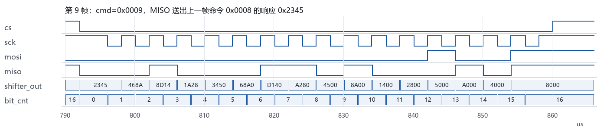

# 实验三：SPI 主机 / 从机通信的 ModelSim 仿真

> 仿真工具：**ModelSim SE-64 10.6e**（脚本自动探测安装位置，也可用环境变量 `MODELTECH` 指定）  
> 设计语言：Verilog-2001  
> 顶层：`spi_top`（主机 + 从机回环）  
> 验证方式：自检查 testbench，20 帧全部通过（0 error）  
> 零基础教程：[教程-零基础完成SPI仿真.md](教程-零基础完成SPI仿真.md)

## 一、实验任务

用 Verilog 编写 SPI 主机和从机模块，建立顶层把二者连接起来，在 ModelSim 中完成仿真，并通过波形说明：

1. 主机能够按照 SPI 协议产生片选 `CS`、时钟 `SCK` 和输出数据 `MOSI`；
2. 从机能够正确接收主机命令，并在 `MISO` 上返回响应；
3. 主机能够正确采样从机返回的数据；
4. 系统连续多帧工作，数据没有错位、丢位或重复。

## 二、通信参数

| 参数 | 取值 | 说明 |
| --- | --- | --- |
| 系统时钟 `clk` | 50 MHz（20 ns） | 主机、从机、帧调度器共用 |
| SPI 时钟 `SCK` | 1 MHz（1 µs） | `HALF_CLK = 25`，半周期 500 ns |
| 数据宽度 | 16 bit | 每帧一个 16 位命令 / 响应 |
| 位序 | MSB first | 先发 bit15，最后发 bit0 |
| 空闲电平 | `SCK = 1`、`CS = 1` | CPOL = 1 |
| SPI 模式 | Mode 2（CPOL=1，CPHA=0） | 下降沿采样、上升沿更新 |
| 采样 / 更新沿 | 下降沿采样，上升沿更新 | 半周期错开，见第四节 |
| 帧内 `CS` 低电平 | 16.5 µs | 16 个 SCK 周期 + 最后半个周期 |
| 帧间 `CS` 高电平 | 2 µs | `GAP_CLK = 100` |
| 帧周期 | 约 18.5 µs | 16.5 + 2 |

> 题目说明“通信参数不限”，因此这里选择 16 位、1 MHz、SPI Mode 2 的固定参数，便于在波形上直接读出每一位。课件参考图标注的是 CPOL=1/CPHA=1，本设计为了把采样沿和更新沿错开半个周期，采用 CPOL=1、CPHA=0（Mode 2），功能上同样是标准 SPI 通信。

## 三、工程结构

```text
exp3/
├─ rtl/
│  ├─ spi_master.v        16 位 SPI 主机（含自加 1 的数据发生器）
│  ├─ spi_slave.v         16 位 SPI 从机（50 MHz 边沿检测 + 命令响应）
│  └─ spi_top.v           顶层：主机、从机连线 + 帧调度器
├─ tb/
│  └─ tb_spi_top.v        自检查 testbench（逐帧比对 + PASS/FAIL）
├─ sim/
│  ├─ spi_wave.do         ModelSim 波形窗口信号分组与显示设置
│  ├─ run_sim.bat         批处理编译 + 仿真（命令行输出验证结果）
│  ├─ run_gui.bat         编译 + 打开 ModelSim GUI 并显示波形
│  ├─ open_project.bat    打开 exp3.mpf 工程
│  ├─ make_project.bat    在本机重建 exp3.mpf（源文件写成相对路径）
│  └─ sim_result.txt      本次仿真的完整命令行记录
├─ images/
│  ├─ wave_overview.png   帧级波形：CS/SCK 突发、命令自加 1
│  ├─ wave_frame.png      位级波形：一帧 16 位的采样与更新
│  ├─ wave_response.png   命令—响应波形：0x2222 / 0x3333 / 0x4444
│  └─ tutorial_*.png      零基础教程用的示意图和界面截图
├─ 教程-零基础完成SPI仿真.md   面向初学者的完整教程
├─ exp3.mpf               ModelSim 工程文件（源文件条目为相对路径）
└─ README.md
```

## 四、SPI 时序设计

### 4.1 为什么把“采样沿”和“更新沿”分开

从机的 `SCK`、`CS` 相对 50 MHz 系统时钟是异步信号，需要先做两级同步再检测边沿；因此从机看到的边沿会比主机晚 2 个时钟（40 ns）。如果收发双方都在同一个 `SCK` 沿“既采样又移位”，仿真和实际电路中都容易出现“采到新位”还是“采到旧位”的竞争。

本设计把两个方向都做成**半周期错开**：

| 方向 | 更新（驱动） | 采样 |
| --- | --- | --- |
| 主机 → 从机（MOSI） | 主机在 `SCK` **上升沿**更新 | 从机在 `SCK` **下降沿**采样 |
| 从机 → 主机（MISO） | 从机在 `SCK` **上升沿**移位 | 主机在 `SCK` **下降沿**采样 |

这样任何一位数据被采样前，都已经稳定了至少半个 SCK 周期（500 ns = 25 个系统时钟），远大于同步器带来的 40 ns 延迟；同一时刻不会出现“一个模块正在改、另一个模块正在采”的情况。

第一位的建立过程：

1. `CS` 下降时，主机把 `tx_data[15]` 送到 `MOSI`；
2. 从机检测到 `CS` 下降，把 `tx_data` 装入输出移位寄存器，`MISO = shifter_out[15]`；
3. 500 ns 后第一个 `SCK` 下降沿到来，双方同时采样第一位，第一位有充分的建立时间。

### 4.2 主机状态机

`spi_master.v` 使用 4 个状态：

| 状态 | 编码 | 动作 |
| --- | --- | --- |
| `S_IDLE` | 0 | `CS=1`、`SCK=1`；收到 `start` 后把 `tx_data` 装入移位寄存器，`CS=0`，`MOSI=tx_data[15]` |
| `S_FALL` | 1 | 等待 25 个时钟（500 ns），拉低 `SCK`，同时采样 `MISO` 存入 `rx_sh` |
| `S_RISE` | 2 | 等待 500 ns，拉高 `SCK`，`MOSI` 更新为下一位，移位寄存器左移，`bit_cnt+1` |
| `S_END` | 3 | 第 16 位采样完后等待 500 ns，拉高 `CS`，锁存 `rx_data`，`tx_data+1`，产生 `frame_done` |

关键点：

- 第 16 个下降沿已经采到 bit0，因此 `S_RISE` 判断 `bit_cnt == 15` 后直接进入 `S_END`，不会再产生第 17 个下降沿；
- `tx_data` 在 `S_END` 自加 1，所以总线上依次出现 `0x0000、0x0001、0x0002 …`；
- `frame_done` 只保持一个时钟，供 testbench 做逐帧检查。

### 4.3 从机边沿检测与移位

`spi_slave.v` 完全用 50 MHz 时钟工作：

```verilog
cs_sync  <= {cs_sync[0],  cs};
sck_sync <= {sck_sync[0], sck};

wire cs_fall  =  cs_sync[1] & ~cs_sync[0];   // 单周期脉冲
wire cs_rise  = ~cs_sync[1] &  cs_sync[0];
wire sck_fall =  sck_sync[1] & ~sck_sync[0];
wire sck_rise = ~sck_sync[1] &  sck_sync[0];
```

`cs_fall / cs_rise / sck_fall / sck_rise` 都是**一个系统时钟宽**的脉冲，因此每个真实边沿只会被响应一次。

| 事件 | 从机动作 |
| --- | --- |
| `CS` 下降 | `shifter_in = 0`；`shifter_out = tx_data`；`bit_cnt = 0` |
| `SCK` 下降 | `shifter_in <= {shifter_in[14:0], MOSI}`；`bit_cnt + 1` |
| `SCK` 上升 | `shifter_out <= {shifter_out[14:0], 1'b0}`（`MISO = shifter_out[15]`） |
| `CS` 上升 | `rx_data <= shifter_in`；按 `shifter_in` 查表得到下一帧的 `tx_data` |

`bit_cnt` 在 16 个下降沿后计到 16，`bit_cnt < 16` 的条件保证不会多移一位。

### 4.4 顶层与帧调度

`spi_top.v` 只做两件事：

1. 把主机的 `spi_cs / spi_sck / spi_mosi` 与从机的 `cs / sck / mosi` 相连，把从机的 `spi_miso` 接回主机；
2. 内置帧调度器：`run=1` 时，只要主机空闲且距上一帧已过 `GAP_CLK=100` 个时钟（2 µs），就产生一个 `start` 脉冲。

因此仿真开始后不需要额外激励，系统会连续自动发送帧；testbench 只负责复位、使能 `run` 和检查结果。

## 五、从机命令响应与一帧延迟

从机在 `CS` 上升沿才能收齐一整条命令，所以**响应只能在下一帧发回**。这是本设计的固定流水线延迟，不是错误。

响应表：

| 从机收到的命令 | 下一帧返回的响应 |
| --- | --- |
| `0x0000` | `0x1111` |
| `0x0004` | `0x2222` |
| `0x0008` | `0x3333` |
| `0x000A` | `0x4444` |
| 其它 | `0xA5A5` |

对应关系举例：

| 帧号 | 主机发送 | 从机本帧收到 | 主机本帧收到 | 说明 |
| --- | --- | --- | --- | --- |
| 0 | `0000` | `0000` | `F00F` | 从机复位初值，尚无命令响应 |
| 1 | `0001` | `0001` | `1111` | 对第 0 帧命令 `0000` 的响应 |
| 2 | `0002` | `0002` | `A5A5` | 对第 1 帧命令 `0001` 的响应 |
| 4 | `0004` | `0004` | `A5A5` | 对第 3 帧命令 `0003` 的响应 |
| 5 | `0005` | `0005` | `2222` | 对第 4 帧命令 `0004` 的响应 |
| 9 | `0009` | `0009` | `3333` | 对第 8 帧命令 `0008` 的响应 |
| 10 | `000A` | `000A` | `A5A5` | 对第 9 帧命令 `0009` 的响应 |
| 11 | `000B` | `000B` | `4444` | 对第 10 帧命令 `000A` 的响应 |

由于主机命令从 0 开始每帧加 1，20 帧内会依次经过 `0x0000、0x0004、0x0008、0x000A`，四种特殊响应都能被覆盖。

## 六、ModelSim 仿真方法

### 6.1 一键运行

```text
exp3\sim\run_sim.bat      命令行模式：编译 + 运行 + 打印 PASS/FAIL
exp3\sim\run_gui.bat      图形模式：编译 + 打开 Wave 窗口，运行到 300 µs
exp3\sim\open_project.bat 打开 exp3.mpf 工程（等价于双击 mpf，用于未关联文件类型时）
exp3\sim\make_project.bat 在本机重建 exp3.mpf（源文件写成相对路径）
```

脚本本身不写死任何绝对路径，运行时会打印实际使用的 `vsim.exe`：

```text
[ModelSim] <ModelSim 安装目录>\win64\vsim.exe
```

ModelSim 的定位顺序是：环境变量 `MODELTECH` → 脚本内置候选路径列表 → `PATH` 上已有的 `vsim`。所以：

- 换到其他电脑：`set MODELTECH=<你的 ModelSim 目录>\win64` 后再运行脚本，无需改脚本；
- 只有 Quartus 自带的 ModelSim-Altera ASE 10.5b 也能跑（脚本候选列表里已包含），已在 10.5b 上实测 20 帧同样 `PASS`。

### 6.2 路径说明（全部相对路径）

仓库里所有文件都不依赖本机绝对路径，`git clone` 到任何目录都能直接用：

| 位置 | 路径写法 |
| --- | --- |
| `run_sim.bat` / `run_gui.bat` / `open_project.bat` | `cd /d "%~dp0"` 切到脚本所在目录，源文件用 `..\rtl\xxx.v` |
| `exp3.mpf` | 源文件条目为 `rtl/spi_master.v`、`tb/tb_spi_top.v` 等相对路径，`others` 为 `$MODEL_TECH/../modelsim.ini` |
| `spi_wave.do` | 只写信号层次名，不含路径 |

有一点要注意：**ModelSim 打开工程后保存时，会把这些相对路径改写成它所在机器的绝对路径**（`ForceSoftPaths = 1` 也挡不住，这是它的保存行为）。所以打开过一次之后 `git status` 里会出现 `exp3.mpf` 的改动，两种处理方式：

```bat
git checkout -- exp3/exp3.mpf     :: 直接丢弃这次改写
exp3\sim\make_project.bat         :: 或者在本机重新生成一份相对路径的工程文件
```

### 6.3 手工命令

在 `exp3\sim` 目录下执行：

```bat
vlib work
vmap work work
vlog -work work ..\rtl\spi_master.v ..\rtl\spi_slave.v ..\rtl\spi_top.v ..\tb\tb_spi_top.v
vsim -c work.tb_spi_top -do "run -all; quit -f"
```

图形模式：

```bat
vsim -gui -voptargs=+acc work.tb_spi_top -do "do spi_wave.do; run 300us"
```

也可以打开 `exp3.mpf` 工程（源文件为相对路径，换机器不需要重建）：

```bat
exp3\sim\open_project.bat
```

工程打开后手动 `Compile > Compile All`，再执行 `do sim/spi_wave.do` 和 `run 300us`。如果 `.mpf` 已经和 ModelSim 关联，直接双击也可。

### 6.3 testbench 的检查内容

`tb_spi_top.v` 在每一帧的 `frame_done` 时刻检查两件事：

1. **从机接收**：`s_rx_data` 是否等于本帧主机发送的命令；
2. **主机接收**：`m_rx_data` 是否等于“上一帧命令对应的响应”。

同时打印帧号、命令、从机接收值、主机接收值和期望值。20 帧全部 `OK` 时输出 `RESULT: PASS`。

## 七、波形分析

以下三张图均从 ModelSim SE-64 10.6e 的 Wave 窗口截取（`run_gui.bat`，运行到 300 µs），信号按 Clock / Reset、SPI Bus、Master、Slave 分组；图中状态栏的 `Now 300 us` 表示截图时的仿真时刻。

### 7.1 帧级波形：CS/SCK 突发与命令自加 1


图中时间为 0～65 µs，包含 3 个完整帧：

- `spi_cs` 出现 3 次低电平突发，每次低电平约 16.5 µs；
- 每次 `CS` 为低期间，`spi_sck` 正好有 16 个周期（1 MHz），`CS` 为高时 `SCK` 保持高电平；
- 主机 `m_tx_data` 依次为 `0000 → 0001 → 0002 → 0003`，说明数据发生器每帧自加 1 工作正常；
- 从机 `s_rx_data` 与主机发送值逐帧相同（`0000、0001、0002`），说明 16 位命令被完整接收，没有错位或丢位；
- 主机 `m_rx_data` 在帧 0 为 `F00F`（从机复位初值），帧 1 变为 `1111`，帧 2 变为 `A5A5`，正好对应“上一帧命令”的响应，体现了从机的固定一帧延迟；
- `m_busy` 在每帧传输期间为高、帧间为低；`frame_done` 在每帧结束处产生一个窄脉冲。

### 7.2 位级波形：一帧 16 位的采样与更新



图中时间范围为 2～20 µs，正好覆盖第 0 帧（`CS` 在约 2.2 µs 拉低，约 18.7 µs 拉高）：

- `spi_sck` 在 `CS` 低电平期间产生 16 个完整周期，第一个下降沿约在 2.7 µs；
- `spi_mosi` 在本帧为 `0x0000`，因此一直保持低电平；
- `spi_miso` 输出从机复位值 `0xF00F`：高 4 位（`1111`）→ 中间 8 位（`0000 0000`）→ 低 4 位（`1111`），波形上表现为“高 4 位、低 8 位、高 4 位”，与 `0xF00F` 的 MSB-first 位序完全一致；
- 主机 `bit_cnt` 从 0 计到 15；从机 `bit_cnt` 从 0 计到 16（16 是“已收满 16 位”的结束标志，不是第 17 位），二者都只处理 16 位，没有多计；
- `cs_fall` 在帧首产生一个单周期脉冲，`cs_rise` 在帧尾产生一个单周期脉冲；
- `sck_fall`、`sck_rise` 在每个 `SCK` 边沿各产生一个单周期脉冲，脉冲之间互不重叠，说明 2 级同步 + 边沿检测没有产生重复响应；
- `m_rx_data` 在本帧结束时由 `0000` 变为 `F00F`，说明主机在 16 个下降沿上正确采到了从机的 16 位响应。

### 7.3 命令—响应波形：四种特殊响应


图中时间范围为 90～230 µs，覆盖命令 `0x0005` 到 `0x000B`：

| 从机命令（`s_rx_data`） | 出现帧 | 主机响应（`m_rx_data`） | 出现帧 |
| --- | --- | --- | --- |
| `0x0004` | 4 | `0x2222` | 5 |
| `0x0008` | 8 | `0x3333` | 9 |
| `0x000A` | 10 | `0x4444` | 11 |

波形上可以直接看到：

- `s_rx_data` 在每一帧 `CS` 上升后更新，依次是 `0004、0005、0006 … 000A、000B`；
- `m_rx_data` 在下一帧 `CS` 上升后更新：命令 `0004` 的下一帧收到 `2222`，命令 `0008` 的下一帧收到 `3333`，命令 `000A` 的下一帧收到 `4444`；
- 其余命令的下一帧收到 `A5A5`，与响应表的 default 分支一致；
- `s_tx_data` 在命令帧结束时已经变成下一帧要发送的响应值（例如 `0004` 帧结束时变为 `2222`），下一帧 `CS` 下降时被装入 `shifter_out`，因此 `MISO` 上出现的正是这个值。

这组波形从“命令进入从机”到“响应回到主机”完整地证明了 SPI 双向通信链路是通的，并且从机的响应逻辑正确。

### 7.4 数据完整性

`tb_spi_top.v` 在 20 帧中逐帧比较：

```text
frame  0 | cmd=0x0000 | slave_rx=0x0000 | master_rx=0xf00f | expected=0xf00f |   OK
frame  1 | cmd=0x0001 | slave_rx=0x0001 | master_rx=0x1111 | expected=0x1111 |   OK
...
frame 11 | cmd=0x000b | slave_rx=0x000b | master_rx=0x4444 | expected=0x4444 |   OK
...
frame 19 | cmd=0x0013 | slave_rx=0x0013 | master_rx=0xa5a5 | expected=0xa5a5 |   OK
--------------------------------------------------
RESULT: PASS - 20 frames checked, 0 errors
--------------------------------------------------
```

完整记录见 [`sim/sim_result.txt`](sim/sim_result.txt)。

## 八、仿真结果

- 编译：`vlog` 0 error、0 warning；
- 仿真：20 帧全部通过，`RESULT: PASS - 20 frames checked, 0 errors`；
- 仿真结束时间：372.81 µs；
- 波形覆盖：帧级（0～65 µs）、位级（2～20 µs）、命令—响应（90～230 µs）三个维度；波形截图取到 300 µs，批处理自检则一直运行到 372.81 µs（20 帧全部完成）；
- 从机对 `0x0000、0x0004、0x0008、0x000A` 分别返回 `0x1111、0x2222、0x3333、0x4444`，其它命令返回 `0xA5A5`，与设计表一致。

> 仿真日志末尾会出现一条 `vsim-8891` 警告（“All optimizations are turned off …”），这是 ModelSim 10.6e 在本工程下关闭 vopt 优化时的提示，不是设计错误，也不影响 20 帧比对结果。

## 九、结论

本实验用 Verilog 完成了 SPI 主机、从机和顶层回环：

1. 主机按 1 MHz、16 位、MSB-first 的时序产生 `CS/SCK/MOSI`，并在下降沿采样 `MISO`；
2. 从机用 50 MHz 时钟对 `CS/SCK` 做同步和边沿检测，在 `CS` 下降时装载输出移位寄存器、在 `SCK` 下降沿采样 `MOSI`、在 `SCK` 上升沿移位 `MISO`，在 `CS` 上升沿锁存命令并准备下一帧响应；
3. 顶层把双方连接成回环，并自动产生帧起始脉冲；
4. 仿真波形显示：每帧 16 个 SCK 周期，命令逐帧自加 1，从机逐帧正确接收，主机逐帧收到上一帧命令对应的响应；20 帧自检 0 错误。

因此可以说明：**当前系统已经完成基本的 SPI 通信，从机能够正确响应主机的命令。**

## 十、备注

- 与课件中的参考代码相比，本设计把数据宽度改为 16 位，并把“采样沿”和“更新沿”分到下降沿 / 上升沿，避免异步边沿检测带来的竞争；同时把课件的 `case (rx_dat[15:0])` 改为直接对 `shifter_in` 判断，避免非阻塞赋值读到旧值导致的两帧延迟。
- `exp3.mpf` 由 ModelSim 自动生成。仓库中的副本已把源文件条目改成相对路径（`rtl/spi_master.v` 等），整个 `exp3` 目录可以随意移动或 `git clone` 到任意位置；但 ModelSim 保存工程时仍会写回本机绝对路径，发现 `git status` 里 mpf 有改动时，用 `git checkout -- exp3/exp3.mpf` 丢弃，或运行 `sim\make_project.bat` 重新生成。
- 源文件注释均为中文。`.bat` 批处理保留英文注释：cmd 按字节解析批处理，UTF-8 中文会把语句拆坏（实测会报 `'pf' 不是内部或外部命令`），而 GBK 中文在 GitHub 上又显示为乱码，因此脚本注释统一用英文，设计源码和波形脚本用中文。
- `.gitignore` 已忽略 `work/`、`*.wlf`、`*.vcd` 等仿真产物，仓库中只保留源码、脚本、工程文件、波形截图和结果记录。
