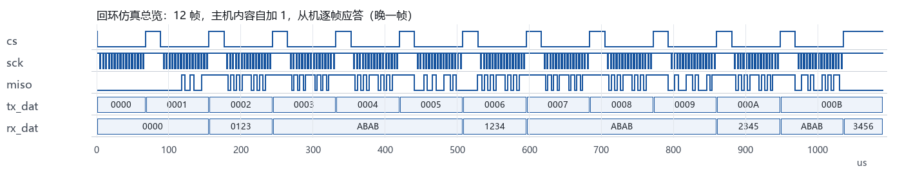
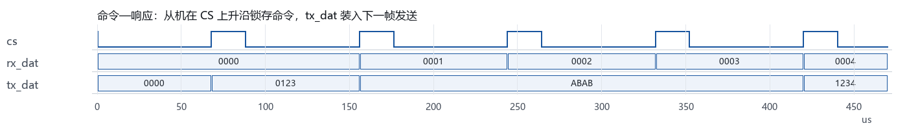

# 实验三：SPI 主从通信（STM32 主机 + EPM240 从机 + ModelSim 仿真）

> 主机：**Keil + STM32F103C8T6**，4 个普通 GPIO 模拟 SPI（软件 SPI）
> 从机：**Quartus + EPM240T100C5**，Verilog 写一个 50 MHz 同步的 SPI 从机
> 仿真：**ModelSim**，主机模型 + 从机 + 顶层，内容自加 1 跑 12 帧
> 教程：[教程-零基础完成SPI通信.md](教程-零基础完成SPI通信.md)

## 一、任务

按课件《软件SPI通信》做三件事：

1. **主机**（课件第 5 页作业）：新建 STM32F103 空工程，新增 `SPI.c`、`SPI.h`、`main.c`，用 SPI 接口循环输出自己定义的字符，每个字符 16 bit；
2. **从机**（课件第 6～8 页）：用 Verilog 写从机，`sck`、`cs` 打一拍做边沿检测，每个 SCK 边沿收发各移一位，`CS` 上升沿锁存命令并用 `case` 决定返回什么；
3. **仿真**（课件第 9～11 页作业）：写主机模块、从机模块、顶层，内容自加 1 连续跑，用波形说明系统正常工作、从机能正确响应命令。

## 二、连线

| 信号 | STM32 | 方向 | CPLD | 说明 |
| --- | --- | --- | --- | --- |
| SPI_CS | PC13 | STM32 → CPLD | PIN_61（IO61） | 片选，低有效 |
| SPI_SCK | PC14 | STM32 → CPLD | PIN_57（IO57） | 时钟，空闲为高 |
| SPI_MOSI | PC15 | STM32 → CPLD | PIN_55（IO55） | 主机输出 |
| SPI_MISO | PA0 | CPLD → STM32 | PIN_53（IO53） | 从机输出 |
| GND | GND | — | GND | **必须共地** |

`clk` 是 CPLD 板载 50 MHz 晶振（QSF 里暂写 `PIN_12`，按自己板子核对）。

## 三、通信参数

| 参数 | 取值 |
| --- | --- |
| 数据宽度 | 16 bit 一帧 |
| 位序 | MSB first |
| CS / SCK 空闲 | 都是高（CPOL = 1） |
| 采样 / 更新 | 下降沿采样 MOSI，上升沿移位 MISO |
| SCK 频率 | 约 200 kHz（半周期 2 µs） |
| 一帧 CS 低 | 68 µs（2 + 16×4 + 2） |
| 帧间 CS 高 | 20 µs |

响应表（从机）：

| 收到 | 下一帧返回 |
| --- | --- |
| `0x0000` | `0x0123` |
| `0x0004` | `0x1234` |
| `0x0008` | `0x2345` |
| `0x000A` | `0x3456` |
| 其它 | `0xABAB` |

响应固定晚一帧：MISO 在 CS 拉低时就得装好，那一刻 16 位命令还没收完，只能回上一帧的答案。

## 四、目录

```text
exp3/
├─ master_stm32/                  Keil 主机工程（双击 Exp3_SPI.uvprojx）
│  ├─ Exp3_SPI.uvprojx / .uvoptx
│  ├─ Exp3_SPI.hex                已编译好的固件
│  ├─ CMSIS/  FWLIB/  STARTUP/    标准外设库
│  ├─ USER/Src/main.c             循环输出自定义字符
│  └─ HARDWARE/
│     ├─ SPI/spi.c, spi.h         ★ 引脚宏定义 + 引脚初始化 + 16 位收发
│     └─ DELAY/delay.c, delay.h   SysTick 微秒延时
├─ rtl/spi_slave.v                ★ 从机（Quartus 顶层，也是仿真里的从机）
├─ cpld/                          Quartus 工程
│  ├─ Exp3_CPLD_Slave.qpf / .qsf
│  └─ Exp3_CPLD_Slave.sdc         50 MHz 时钟约束
├─ tb/                            ModelSim 仿真
│  ├─ spi_master.v                主机模型（内容自加 1）
│  ├─ spi_top.v                   顶层：主机 + 从机连线
│  └─ tb_spi_top.v                testbench：时钟 + 打印
├─ sim/                           exp3.mpf、run_sim.bat、run_gui.bat、spi_wave.do、sim_result.txt
├─ images/                        wave_overview / wave_frame / wave_response
├─ 教程-零基础完成SPI通信.md
├─ 任务目标-SPI主从通信.txt
└─ 软件SPI通信.pdf
```

只有 4 个源文件是我们要写的：`spi.c`、`spi.h`、`main.c`、`spi_slave.v`（外加 3 个仿真文件）。

## 五、从机：`rtl/spi_slave.v`

整个从机 40 行有效代码，三段：

```verilog
// 1. 打一拍，和原信号比较得到边沿脉冲
always @(posedge clk) begin
    cs_tmp  <= cs;
    sck_tmp <= sck;
end
wire cs_fall  =  cs_tmp & ~cs;
wire cs_rise  = ~cs_tmp &  cs;
wire sck_fall =  sck_tmp & ~sck;
wire sck_rise = ~sck_tmp &  sck;
```

```verilog
// 2. 帧首装数据，SCK 边沿收发
if (cs_fall) begin
    shifter_in  <= 16'h0000;
    shifter_out <= tx_dat;              // 装上上一帧算好的响应
    bit_cnt     <= 5'd0;
end
else begin
    if (sck_fall && bit_cnt < 16) begin
        shifter_in <= {shifter_in[14:0], mosi};   // 收一位
        bit_cnt    <= bit_cnt + 1'b1;
    end
    if (sck_rise && bit_cnt < 16) begin
        shifter_out <= {shifter_out[14:0], 1'b0}; // 移一位，MISO 自动换下一位
    end
end
```

```verilog
// 3. 帧尾锁存命令 + 查表准备下一帧
if (cs_rise) begin
    rx_dat <= shifter_in;
    case (shifter_in)
        16'h0000: tx_dat <= 16'h0123;
        16'h0004: tx_dat <= 16'h1234;
        16'h0008: tx_dat <= 16'h2345;
        16'h000A: tx_dat <= 16'h3456;
        default : tx_dat <= 16'hABAB;
    endcase
end
```

`miso` 直接就是 `shifter_out[15]`。寄存器都给了初值，MAX II 上电为 0，所以不需要复位脚。

## 六、主机：`master_stm32/HARDWARE/SPI/`

`spi.h` 只做两件事：引脚宏定义 + 声明两个函数，换板只改这里。

```c
#define SPI_CS_PORT   GPIOC
#define SPI_CS_PIN    GPIO_Pin_13
#define SPI_CS_H()    GPIO_SetBits(SPI_CS_PORT, SPI_CS_PIN)
#define SPI_CS_L()    GPIO_ResetBits(SPI_CS_PORT, SPI_CS_PIN)
#define SPI_MISO      GPIO_ReadInputDataBit(SPI_MISO_PORT, SPI_MISO_PIN)
```

`spi.c` 的收发一帧就 4 步（写的同时把从机的数据读回来）：

```c
SPI_CS_L();
for (i = 0; i < 16; i++) {
    if (tx_dat & 0x8000) SPI_MOSI_H(); else SPI_MOSI_L();  // 1. SCK 高时摆数据
    tx_dat <<= 1;
    delay_us(2);
    SPI_SCK_L();                                            // 2. 下降沿
    rx_dat = (rx_dat << 1) | SPI_MISO;                      //    主机同时采样
    delay_us(2);
    SPI_SCK_H();                                            // 3. 上升沿，从机移位
}
SPI_CS_H();
```

`main.c` 就是课件要求的“输出字符”：

```c
const u16 CHAR_TAB[] = { 0x0000, 0x0004, 0x0008, 0x000A, 0x0055, 0x00AA };

while (1) {
    g_tx = CHAR_TAB[i];
    g_rx = SPI_WriteRead(g_tx);        // 发一个字符，同时收回响应
    i = (i + 1) % 6;
    delay_ms(200);
}
```

编译结果：**0 error、0 warning**，代码 1.3 KB + 常量 0.3 KB，RAM 约 1.7 KB。

## 七、仿真

主机模型 `tb/spi_master.v` 的时序和 `spi.c` 完全一样，只是用 `#` 延时来写；`spi_top.v` 把主机和从机连起来。

```text
exp3\sim\run_sim.bat      命令行：编译 + 跑完 12 帧 + 打印结果
exp3\sim\run_gui.bat      图形界面：编译 + 打波形窗口
```

运行结果：

```text
frame  0 : cmd=0000   slave_rx=0000   master_rx=0000
frame  1 : cmd=0001   slave_rx=0001   master_rx=0123
frame  2 : cmd=0002   slave_rx=0002   master_rx=abab
frame  3 : cmd=0003   slave_rx=0003   master_rx=abab
frame  4 : cmd=0004   slave_rx=0004   master_rx=abab
frame  5 : cmd=0005   slave_rx=0005   master_rx=1234
frame  6 : cmd=0006   slave_rx=0006   master_rx=abab
frame  7 : cmd=0007   slave_rx=0007   master_rx=abab
frame  8 : cmd=0008   slave_rx=0008   master_rx=abab
frame  9 : cmd=0009   slave_rx=0009   master_rx=2345
frame 10 : cmd=000a   slave_rx=000a   master_rx=abab
frame 11 : cmd=000b   slave_rx=000b   master_rx=3456
```

- `slave_rx` 每帧都等于 `cmd`：从机 16 位全部收对；
- `master_rx` 依次出现 `0123 / 1234 / 2345 / 3456 / abab`：四种特殊命令全部命中，其它走 default；
- 命令 `0000` 的答案 `0123` 出现在第 1 帧，命令 `0004` 的答案 `1234` 出现在第 5 帧——正好晚一帧。

完整记录见 [`sim/sim_result.txt`](sim/sim_result.txt)，仿真到 1200 µs 结束，`vlog` 0 error 0 warning。

## 八、波形

### 8.1 总览：12 帧，内容自加 1



`cs` 有 12 次低电平突发（每次 68 µs），`tx_dat` 从 `0000` 加到 `000B`；`rx_dat` 依次是 `0000 → 0123 → ABAB … → 1234 … → 2345 … → 3456`，每一段都比 `tx_dat` 晚一帧。

### 8.2 一帧 16 位


以第 9 帧（`cmd=0009`）为例：`cs` 低 68 µs，期间 `sck` 正好 16 个周期；`mosi` 上是 `0009` 的位序；`miso` 送出的是上一帧命令 `0008` 的响应 `0x2345`；`shifter_out` 每来一个上升沿左移一位（`2345 → 468A → 8D14 → … → 8000`），`bit_cnt` 从 0 数到 16。

### 8.3 命令与响应



`rx_dat` 在 `cs` 上升沿更新为刚收到的命令；同一个沿上 `tx_dat` 换成新命令对应的响应，等下一帧 `cs` 拉低时被装进 `shifter_out` 发出去——这就是“晚一帧”的由来。

## 九、上板

1. Quartus 打开 `cpld/Exp3_CPLD_Slave.qpf` → 核对 `clk` 引脚 → `Start Compilation` → Programmer 里烧 `.pof`（JTAG）；
2. 按第二节的表连 4 根线 + GND；
3. Keil 打开 `master_stm32/Exp3_SPI.uvprojx` → `Build`（0 error）→ 下载；
4. Keil 里 `Debug` 运行，把 `g_tx`、`g_rx` 加到 Watch 窗口：`g_tx` 每 200 ms 变一次，`g_rx` 是上一条字符对应的响应。

| 现象 | 原因 |
| --- | --- |
| `g_rx` 一直是 `FFFF` | MISO 没接 / CPLD 没上电 / 没共地 |
| `g_rx` 一直是 `0000` | `CS`、`SCK` 没到从机，或 MISO 被拉低 |
| `g_rx` 有数但和表不符 | 两边响应表不一致（`spi_slave.v` 的 `case`） |

## 十、结论

1. 主机用 4 个 GPIO 实现了 16 位、MSB first、SCK 空闲高的 SPI 时序，能连续输出自定义字符并收回从机数据；
2. 从机用打一拍的方式得到 `cs`/`sck` 的边沿脉冲，在 SCK 两个边沿上同时收发，在 CS 上升沿锁存命令并查表应答；
3. 仿真 12 帧：从机每帧都收到正确命令，主机的 `master_rx` 依次出现 `0123/1234/2345/3456/ABAB`，证明**系统已正常工作、从机能正确响应主机命令**；
4. Quartus 综合 57/240 逻辑单元（24%），50 MHz 下 setup 裕量 +10.3 ns。

## 十一、备注

- 课件里从机的 `tx_dat` 是 32 位、写成 `32'h01230123` 这种高低半字相同的值，而真正上总线的只有 16 位；本实验直接定义成 16 位（`0x0123`），数值和课件传的那 16 位一致，省掉永远发不出去的高半字。
- 课件第 9 页提到“`cs` 和 `cs_tmp` 之间设计延迟，以确保……”：本实验把这个延迟做在主机侧——`CS` 拉低后先等半个周期再发第一个 SCK，从机有充分时间装载 `shifter_out`。
- 从机没有复位脚：寄存器写了初值，MAX II 上电即为 0，`ModelSim` 也从 0 开始。
- 源文件编码：`.c/.h` 为 GB2312（Keil 默认 ANSI），`.v/.do/.md` 为 UTF-8；`.bat` 注释用英文（cmd 按字节解析批处理）。
- `Exp3_SPI.hex` 可直接烧；重新编译会覆盖它。`exp3.mpf` 被 ModelSim 打开一次后会写回绝对路径，需要时运行 `sim\make_project.bat` 重新生成。
