# exp3 图形界面仿真教程（ModelSim + Keil）

> **这份教程全部用鼠标点菜单、点按钮完成**：不用命令行、不用脚本、不用记 Tcl。
> 截图取自本机真实软件界面（ModelSim-Altera 10.5b、Keil µVision 5）。原界面较小，图片已裁切放大，文字可以按需要继续缩放查看。
> 配套代码见同目录 `README.md` 和 `教程-零基础完成SPI通信.md`，本文件只讲**界面怎么点**。

---

## 0. 先认识三个窗口和要打开的文件

| 软件 | 从哪儿打开 | 要打开的文件 | 干什么 |
| --- | --- | --- | --- |
| ModelSim | 开始菜单 → ModelSim / ModelSim-Altera | `exp3\sim\exp3.mpf` | 仿真从机，看 SPI 波形 |
| Keil µVision | 桌面 µVision 图标 | `exp3\master_stm32\Exp3_SPI.uvprojx` | 编译 STM32 主机、软件仿真打断点 |
| Quartus | 桌面 Quartus | `exp3\cpld\Exp3_CPLD_Slave.qpf` | 把从机烧进 EPM240（本教程不作重点） |

**仿真时的父子关系**（记住这张对应关系，后面看波形不会迷路）：

```
tb_spi_top.v      ← testbench：产生 50 MHz 时钟，跑 12 帧后打印结果
└── dut (spi_top) ← 顶层连线：把主机和从机的 4 根线接起来
    ├── u_master  ← spi_master.v：仿真用的主机模型（真机对应 STM32）
    └── u_slave   ← spi_slave.v ：从机（真机对应 EPM240）
```

---

## 1. ModelSim：打开工程

1. 双击桌面上的 **ModelSim**（标题是 `ModelSim - INTEL FPGA STARTER EDITION`）。
2. 点菜单 **File → Open Project...**。
3. 弹出的文件对话框里，把地址栏改成：

   `G:\Programs\Course\DigitalElectronicDesign\exp3\sim`

4. 在文件列表里单击选中 **`exp3.mpf`**，点 **打开**。
5. 左侧 **Project** 面板出现 4 个文件：`spi_master.v`、`spi_top.v`、`spi_slave.v`、`tb_spi_top.v`，如下图所示。

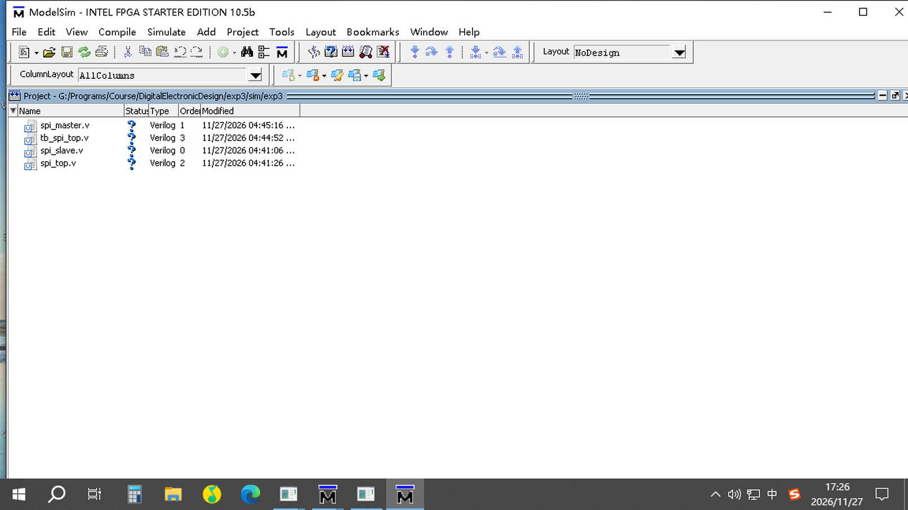

> **注意**：`exp3` 文件夹的**上一级**也有一个旧的 `exp3.mpf`。一定要打开 `sim` 文件夹里那个，否则会提示 “Project file ... was not found”。

---

## 2. 第一次打开要先建 work 库

ModelSim 需要一个名为 **work** 的工作库才能编译。如果你刚清理过工程目录，第一次编译时 4 个文件状态列会出现 **红色 ×**，Transcript 里写着 `Compile ... failed with 1 errors`。

只做一次：

1. 点菜单 **File → New → Library...**。
2. 对话框里 `Library Name` 填 **work**，其它不用改。
3. 点 **OK**。左侧 **Library** 面板里出现 `work` 即可。

建完库再编译，红色 × 就会变成绿色 √。

---

## 3. 编译：右键 → Compile All

1. 在 **Project** 面板 4 个文件下面的**空白处**点鼠标右键。
2. 菜单里选 **Compile All**。
3. 点下方 **Transcript** 标签，看到绿色的：

   ```
   # Compile of spi_slave.v was successful.
   # Compile of spi_master.v was successful.
   # Compile of spi_top.v was successful.
   # Compile of tb_spi_top.v was successful.
   # 4 compiles, 0 failed with no errors.
   ```

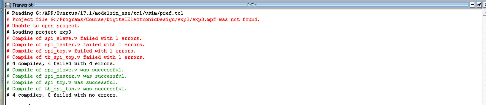

图里上半部分的红字是**没建 work 库时**的失败记录，下半部分绿字是建库后重新编译的成功记录。看到 `0 failed` 就可以继续了。

---

## 4. 开始仿真：Simulate → Start Simulation

1. 点菜单 **Simulate → Start Simulation...**。
2. 对话框 **Design** 标签页里，找到 **work** 这一行，点左边的 `+` 展开。
3. 单击选中 **tb_spi_top**，对话框下方的 `Design Unit(s)` 输入框里会出现 `work.tb_spi_top`。
4. 点 **OK**。

启动成功后界面会变成三块（见下图）：

| 区域 | 看什么 |
| --- | --- |
| 左上 **sim** | 设计层次树：`tb_spi_top → dut → u_master / u_slave` |
| 右上 **Objects** | 当前层的信号：`clk / cs / sck / mosi / miso / frame / started` |
| 右下 **Processes** | 各个 always / initial 进程的状态（Ready / Active） |

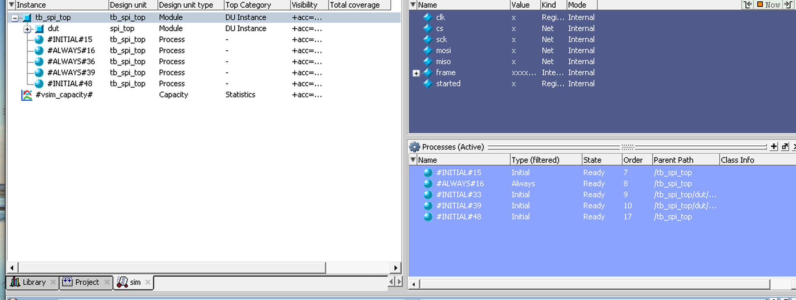

此时仿真时间是 **0 ps**，还没有波形——下一步把信号放进波形窗口。

---

## 5. 添加波形：选中信号 → Ctrl+W

1. 在 **Objects** 面板里单击 `cs`。
2. 按住 **Ctrl** 依次单击 `sck`、`mosi`、`miso`，让 4 行同时高亮。
3. 在选中的行上点**右键**，菜单里选 **Add → Add to Wave → Selected Signals**；也可以直接按快捷键 **Ctrl+W**（推荐，最省事）。

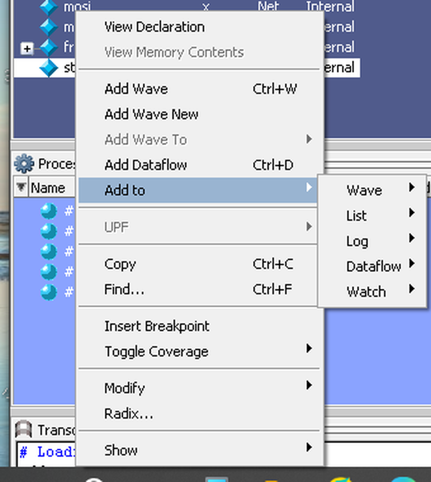

4. 想看总线数值，就在 **sim** 面板里展开 `dut → u_master`、`dut → u_slave`，把 `tx_dat`、`rx_dat`、`shifter_out`、`bit_cnt` 也按上面的方法加进波形窗口。
5. 波形窗口里点 **File → Save...** 可以把这次的信号列表保存起来，下次不用重新添加。

添加完成后，波形窗口左边会出现三组信号（下图里的 `SPI pins / Master / Slave`）：

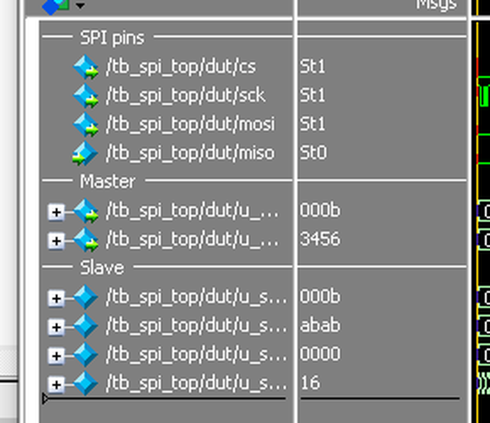

---

## 6. 设置仿真时间并运行

这是最容易卡住的一步，注意**时间框的单位**。

### 6.1 设置每次运行多长时间

波形窗口工具栏上有一个显示 **`100 ps`** 的框（下图中红框位置）：

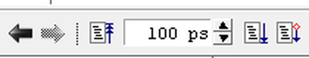

1. 单击这个框，把里面的 `100 ps` 改成 **`1200 us`**（`us` 就是微秒）。
2. 按回车确认。之后每点一次“运行”按钮，仿真就往前走 1200 µs。

> 12 帧 × 约 88 µs ≈ 1056 µs，所以 **1200 us** 刚好跑完全部帧。写 `1200 ms` 就太大了，波形会稀得看不清。
> 也可以走菜单：**Simulate → Run → Run Length...**，在弹出的框里填 `1200 us`。

### 6.2 运行

- 点工具栏上的**运行按钮**（蓝色三角形 `Run`），或点菜单 **Simulate → Run**。
- 想一次跑到底，点 **Simulate → Run -All**。

### 6.3 调整波形显示

| 想做什么 | 鼠标怎么点 |
| --- | --- |
| 看全部波形 | 波形窗口工具栏的 **Zoom Full**（放大镜带方框那个图标），或菜单 **View → Zoom → Full** |
| 放大某一帧 | 在波形区域**滚动鼠标滚轮**，或按住鼠标左键框选一段时间后放开 |
| 总线显示成十六进制 | 在 `tx_dat` 那一行点右键 → **Radix → Hexadecimal**（默认有时是二进制，很长） |
| 删除某个信号 | 在波形窗口选中该行，按 **Delete** |

### 6.4 应该看到的结果

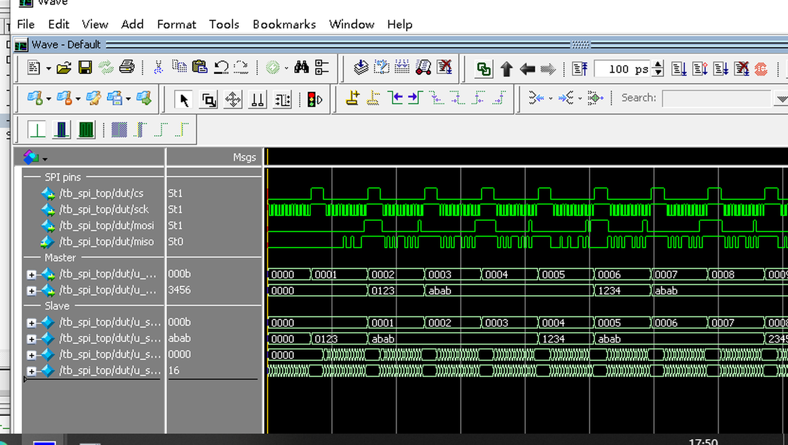

对着图读一遍：

1. `cs` 一共拉低 **12 次**，每次约 68 µs，这就是 12 帧。
2. `sck` 在 CS 低期间跳变 **16 次**，一帧传 16 位，MSB 先发。
3. `tx_dat`（主机发送）从 `0000`、`0001` 一直加到 `000B`。
4. `rx_dat`（主机收回）依次出现 `0123 / 1234 / 2345 / 3456 / abab ...`。
5. `u_slave/rx_dat` 与主机当帧发出的数据相同，`u_slave/tx_dat` 就是下一帧 MISO 要回的数据——**响应固定晚一帧**，这是从机结构决定的，不是错误。

> 仿真跑完时 ModelSim 可能弹一个 **Finish Vsim** 确认框，问 `Are you sure you want to finish?`。点 **否(N)** 才能保留当前波形；点“是”会退出仿真，波形就没了。

---

## 7. ModelSim 里打断点、单步

1. 在左上 **sim** 面板里**双击** `tb_spi_top.v`，源码窗口打开。
2. 在代码左侧**行号旁边的灰色窄栏**单击一下，出现一个**红色圆点**，就是断点。
   （课程代码里 `tb_spi_top.v` 第 56 行是 `$finish;`，在那一行打断点很直观。）
3. 点 **Simulate → Run -All** 运行。程序会停在红点那一行，该行变成蓝色高亮，左边出现**黄色小箭头**。
4. Transcript 中会打印 `Break in Module tb_spi_top at ... line 56`，如下图所示。

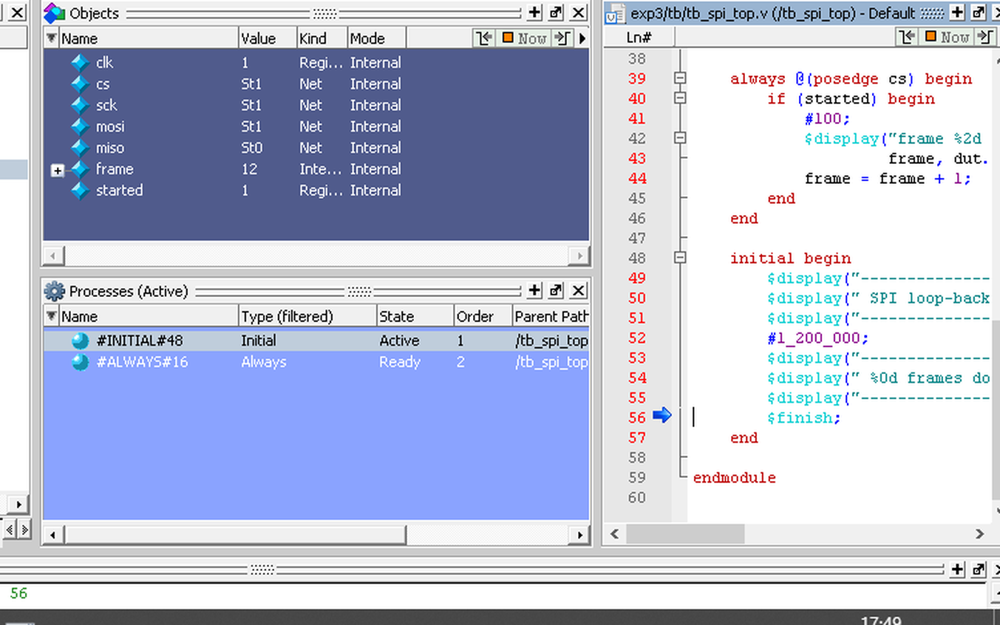

5. 停下来以后，用菜单 **Simulate → Step**（单步进入）、**Step Over**（单步跳过）继续走；点 **Run -All** 恢复全速运行。
6. 不想打断点了，再点一次那个红点即可取消；菜单 **Simulate → Delete Breakpoint...** 也可以统一删除。

---

## 8. Keil：打开工程并编译

1. 双击桌面 **µVision** 图标。
2. 点菜单 **Project → Open Project...**，找到：

   `G:\Programs\Course\DigitalElectronicDesign\exp3\master_stm32\Exp3_SPI.uvprojx`

3. 左侧 **Project** 面板出现 5 个组：`CMSIS`、`STARTUP`、`FWLIB`、`USER`、`HARDWARE`。双击 `HARDWARE → SPI → spi.c` 和 `USER → main.c` 可以打开源码。

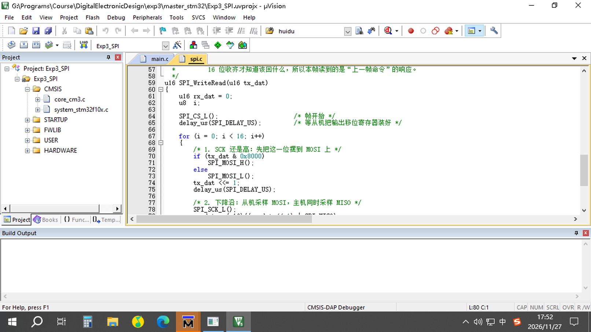

4. 点菜单 **Project → Rebuild all target files**（把全部文件重建一遍，比普通 Build 干净）。
5. 下方 **Build Output** 面板里滚到最后，应看到：

   ```
   Program Size: Code=1292 RO-data=280 RW-data=28 ZI-data=1636
   ".\Objects\Exp3_SPI.axf" - 0 Error(s), 0 Warning(s).
   ```

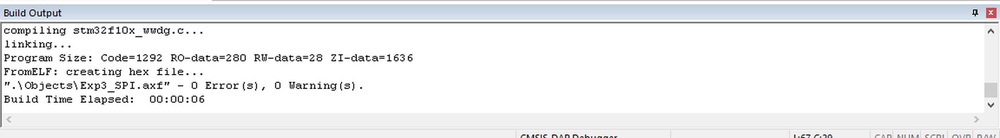

> 如果报一堆 `cannot open source input file`，说明 Keil 打开的是**旧的错误工程文件**。关掉 Keil（提示保存时选“否”），重新打开上面那个路径，再 Rebuild。磁盘上的工程路径已经修好了，但 Keil 内存里可能还缓存着旧路径。

---

## 9. Keil：软件仿真 + 断点测试（没接开发板也能做）

### 9.1 切换到软件仿真

1. 点 **Project → Options for Target 'Exp3_SPI'...**。
2. 对话框里点 **Debug** 标签页。
3. 右侧单选按钮选 **Use Simulator**（使用软件仿真），点 **OK**。
   （如果接了调试器并想烧程序，就选右边的硬件调试器，这里不用。）

### 9.2 进入调试模式

点菜单 **Debug → Start/Stop Debug Session**，或直接按 **Ctrl+F5**。窗口布局会变化，状态栏右下角显示 **`Simulation`**，工具栏多出单步、运行等按钮。

### 9.3 打断点并运行

1. 打开 `main.c`，找到第 44～45 行：

   `SPI_WriteMsg(g_tx, 1);      /* 写一帧：发出本字符 */`
   `SPI_ReadMsg(&g_rx, 1);      /* 读一帧：收回上一条字符的响应 */`

2. 在其中一行**行号左边的灰色窄栏**单击，出现**红色圆点**。
   （下图是在旧版 `spi.c` 的 `return rx_dat;` 那一行打的断点，操作完全一样；现在可以在 `SPI_WriteData()` 或 `SPI_ReadData()` 里打。）

3. 点菜单 **Debug → Run**，或按 **F5**。程序全速运行，遇到断点会停下来：该行变成蓝色高亮，左边有**黄色小箭头**。

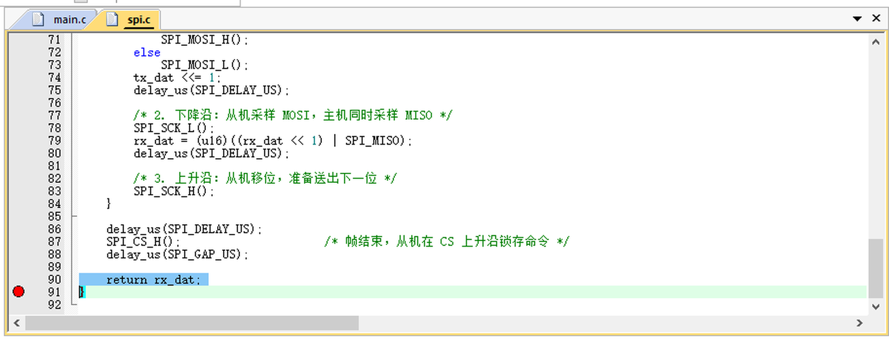

4. 想看变量：点菜单 **View → Watch Windows → Watch #1**，在 Watch 窗口的 `Name` 列第一行输入 `g_tx` 回车，第二行输入 `g_rx` 回车。每停一次断点，这两个值就会刷新；对照 `CHAR_TAB` 就能看到 `0000 → 0004 → 0008 → 000A → 0055 → 00AA` 循环。

5. 调试常用按钮（都在 **Debug** 菜单里）：

| 菜单项 | 快捷键 | 作用 |
| --- | --- | --- |
| Run | F5 | 全速跑到下一个断点 |
| Step | F11 | 单步**进入**函数（会进到 `SPI_WriteMsg` / `SPI_ReadMsg`，再到 `SPI_WriteData` / `SPI_ReadData` 内部） |
| Step Over | F10 | 单步**跳过**函数（把一次 SPI 传输当成一步） |
| Step Out | Ctrl+F11 | 从当前函数里跳出来 |
| Stop | — | 停止运行 |
| Start/Stop Debug Session | Ctrl+F5 | 退出调试模式，回到编辑状态 |

---

## 10. 把 Keil 变量和 ModelSim 波形对起来看

两边跑的是**同一套时序**（16 位、MSB first、SCK 空闲高、半周期 2 µs）：

- Keil 里 `g_tx` 的当前值 → 对应 ModelSim 波形里 `u_master/tx_dat`。
- Keil 里 `g_rx` 的当前值 → 对应 ModelSim 波形里 `u_master/rx_dat`。
- 从机响应在 `0000 / 0004 / 0008 / 000A` 时分别是 `0123 / 1234 / 2345 / 3456`，其它命令回 `ABAB`；因为从机在 CS 拉低时就要把 MISO 装好，**响应比命令晚一帧**。

联调时如果发现 Keil 读回的数据不对，先在 ModelSim 里把同一帧的 `mosi / miso / sck` 放大看位序，再去 Keil 里用 F11 单步检查 `SPI_WriteData()` / `SPI_ReadData()` 里每一位的顺序。注意 C 程序是“写一帧、再读一帧”，仿真主机为了看图方便把收发合成一帧，响应都晚一帧。

---

## 11. 常见问题

| 现象 | 鼠标怎么解决 |
| --- | --- |
| 打开工程提示 `Project file ... was not found` | File → Open Project 重新选 `sim\exp3.mpf`，别选上一级那个 |
| 4 个文件状态列是红色 × | File → New → Library... 建一个叫 `work` 的库，再右键 Compile All |
| 波形窗口是空的 | 回到 Objects 面板选中信号，按 Ctrl+W；或者 Window 菜单 → Wave 把波形窗口调出来 |
| 跑一次只有 100 ps，看不到东西 | 把工具栏时间框从 `100 ps` 改成 `1200 us` 再点 Run |
| 总线显示成一长串 0/1 | 波形窗口右键该行 → Radix → Hexadecimal |
| 仿真完波形消失 | Finish Vsim 弹窗要点“否(N)” |
| Keil 报找不到源文件 | 关闭 Keil 再重新打开 `Exp3_SPI.uvprojx`，然后 Rebuild all target files |
| Keil 注释显示成乱码 | 源码是 GB2312 编码，用 Keil 自带的编辑器打开即可，不要另存为 UTF-8 |
| 初始化函数重名 | 我们的初始化函数叫 `SPI_GPIO_Config()`（课件里的名字），不要改成 `SPI_Init`（和标准库重名） |

> 本机独立桌面的分辨率被固定为 1152×648，无法从软件里改大；点窗口右上角的最大化按钮可以让窗口占满屏幕，本教程的截图也已经做过裁切放大。
