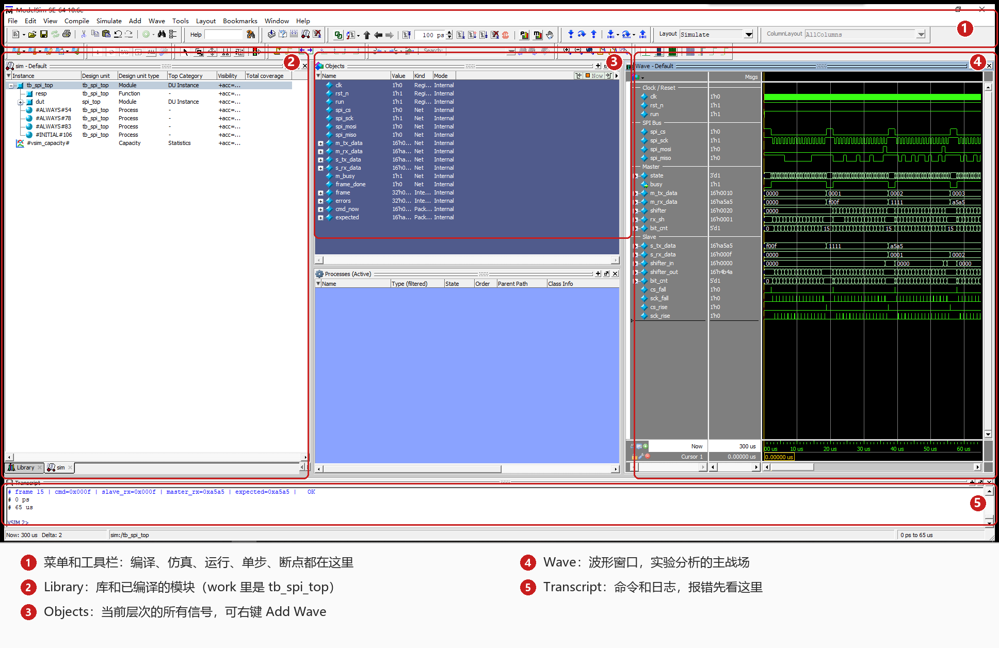
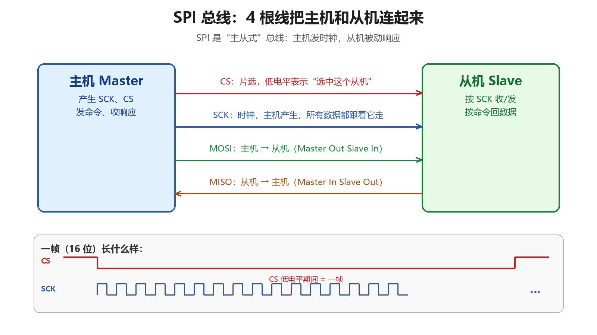
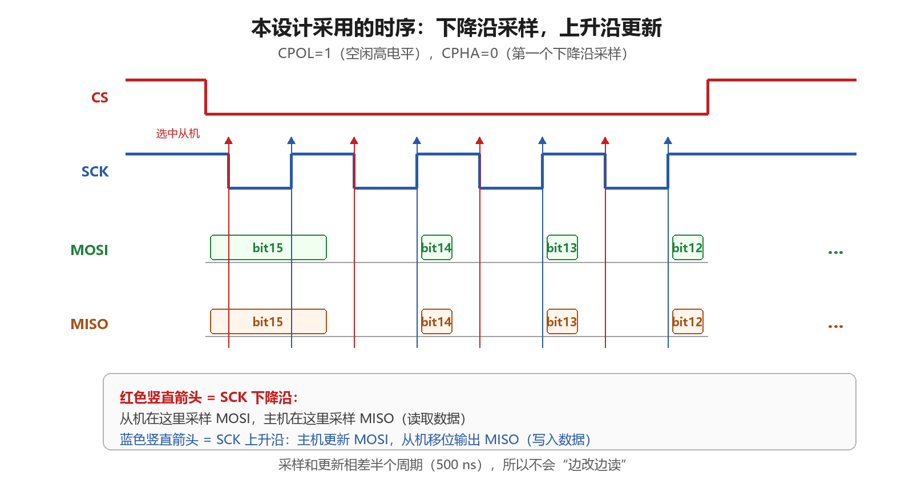
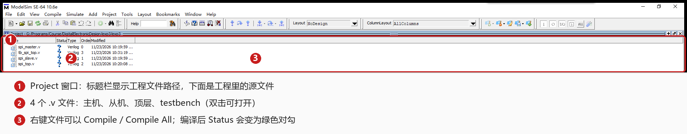
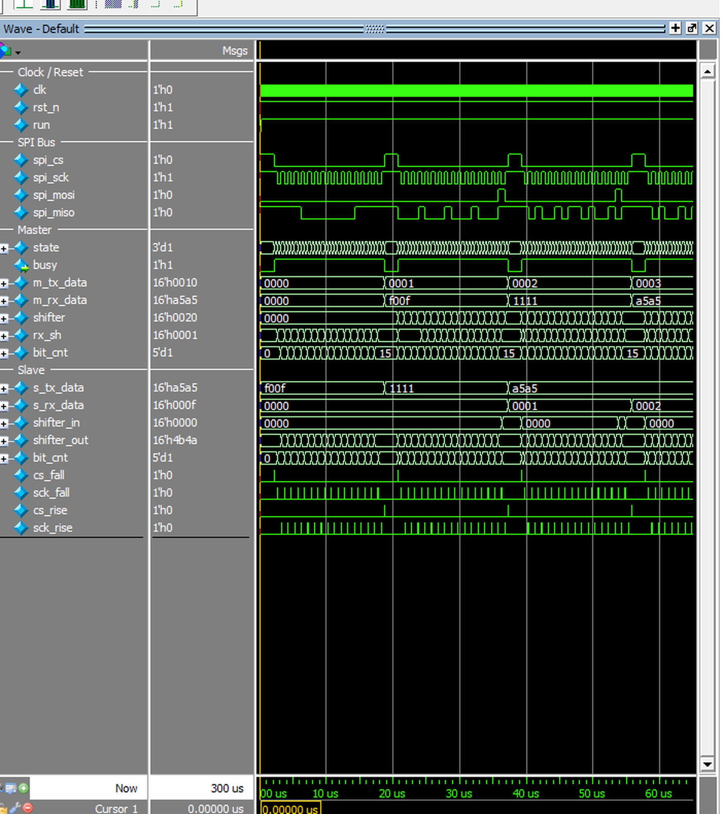
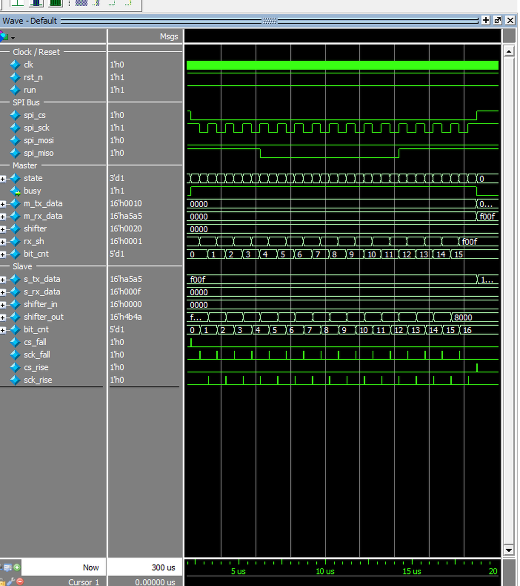
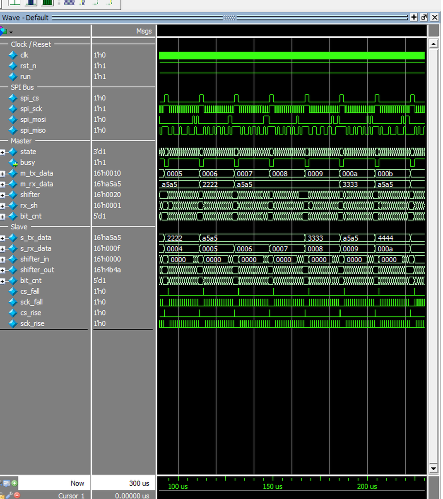
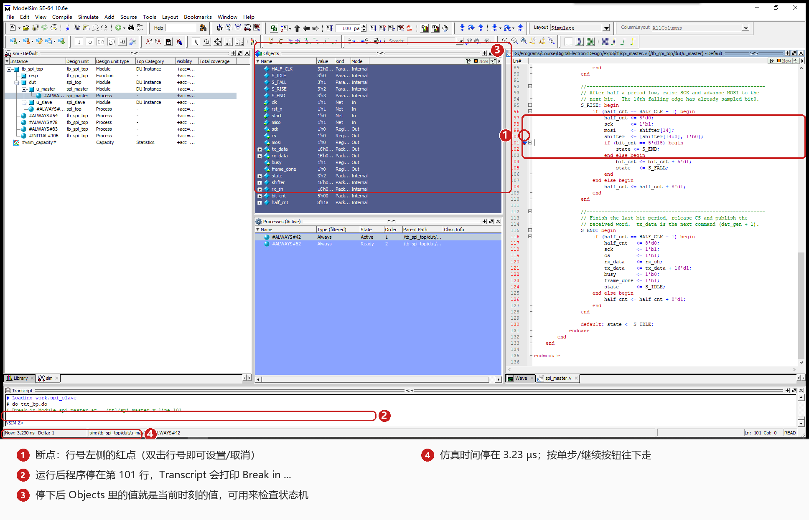

# 零基础教程：从“只会 C”到完成 SPI 主机/从机 ModelSim 仿真

> 适用对象：没学过 SPI、没写过 Verilog、没用过 ModelSim、没做过仿真和断点调试，但会一点 C 语言。  
> 配套工程：[exp3 工程说明](README.md)  
> 仿真工具：ModelSim SE-64 10.6e  
> 最终目标：能自己建立工程、编译、跑仿真、看波形、下断点，并能用波形解释“从机正确响应了主机”。

---

## 目录

1. [先跑起来：10 分钟看到结果](#一先跑起来10-分钟看到结果)
2. [SPI 到底是什么](#二spi-到底是什么)
3. [Verilog 速成：只学项目里用到的](#三verilog-速成只学项目里用到的)
4. [工程文件怎么管](#四工程文件怎么管)
5. [在 ModelSim SE-64 里建立工程](#五在-modelsim-se-64-里建立工程)
6. [代码逐段解读](#六代码逐段解读)
7. [仿真、看波形、断点调试](#七仿真看波形断点调试)
8. [用波形回答实验问题](#八用波形回答实验问题)
9. [常见问题 FAQ](#九常见问题-faq)
10. [命令速查表](#十命令速查表)
11. [练习](#十一练习)

---

## 一、先跑起来：10 分钟看到结果

刚接触一个新工具，最怕“还没看到结果，就被一堆概念劝退”。所以我们先不解释原理，先把现成工程跑起来。

### 1.1 跑命令行仿真

打开文件资源管理器，进入：

```text
G:\Programs\Course\DigitalElectronicDesign\exp3\sim
```

双击 **`run_sim.bat`**。会弹出一个黑色命令行窗口，自动做四件事：

1. 建立 `work` 库；
2. 用 `vlog` 编译 4 个 `.v` 文件；
3. 用 `vsim` 启动仿真；
4. 运行 20 帧并逐帧检查。

运行结束后窗口会停在“请按任意键继续”，方便你看结果；按任意键关闭。

看到下面这几行，就说明成功了：

```text
# frame  0 | cmd=0x0000 | slave_rx=0x0000 | master_rx=0xf00f | expected=0xf00f |   OK
# frame  1 | cmd=0x0001 | slave_rx=0x0001 | master_rx=0x1111 | expected=0x1111 |   OK
...
# frame 19 | cmd=0x0013 | slave_rx=0x0013 | master_rx=0xa5a5 | expected=0xa5a5 |   OK
# --------------------------------------------------
# RESULT: PASS - 20 frames checked, 0 errors
# --------------------------------------------------
```

> `PASS` 的意思是：testbench 自动比对了 20 帧，从机收到的命令、主机收到的响应全部正确。

### 1.2 打开图形界面看波形

双击 **`run_gui.bat`**。它会编译、启动 ModelSim 图形界面、把信号加到 Wave 窗口，并运行 300 µs。

你会看到类似下图（图里已经标出各区域）：



> 如果双击后窗口一闪而过，多半是 ModelSim 安装路径不同。用记事本打开 `run_sim.bat` / `run_gui.bat`，把 `set MODELTECH=G:\APP\modeltech64_10.6e\win64` 改成你电脑上的 `win64` 目录即可。

先不用管每个按钮，只要知道：

- 左边 **Library**：编译好的模块；
- 中间 **Objects**：当前模块里的所有信号；
- 右边 **Wave**：波形；
- 下边 **Transcript**：日志，出问题先看这里。

### 1.3 这一节的任务

- [ ] 能独立双击 `run_sim.bat`，看到 `PASS`；
- [ ] 能打开 `run_gui.bat`，看到 Wave 窗口；
- [ ] 知道 Transcript 在哪里。

做完这三件事，再往下看原理，就不会觉得“学了没用”。

---

## 二、SPI 到底是什么

### 2.1 一句话版本

SPI 是一种“**主机问、从机答**”的同步串行通信方式：

- **主机（Master）**：产生时钟，决定什么时候发、什么时候收；
- **从机（Slave）**：听主机的时钟，按节拍收数据、回数据；
- 数据是一根线一位一位传的，不是一次传一整个字节。

### 2.2 用生活场景理解

把主机想成老师，从机想成学生：

| SPI 信号 | 生活类比 | 作用 |
| --- | --- | --- |
| `CS` | 老师点名“某某同学” | 低电平表示选中这个从机 |
| `SCK` | 老师打拍子“1、2、1、2” | 每个节拍传一位 |
| `MOSI` | 老师说的话 | 主机 → 从机 |
| `MISO` | 学生的回答 | 从机 → 主机 |

老师点名之前，学生不吭声；点名（`CS` 拉低）之后，老师打一拍说一位，学生也跟着节拍听一位、答一位；说完 16 拍，老师取消点名（`CS` 拉高），一次通信结束。

### 2.3 四根线长什么样



注意几个细节：

1. **`CS` 是低电平有效**：平时是高电平，拉低才表示“选中”。所以图里 `CS` 是“先高、再低、最后高”。
2. **`SCK` 由主机产生**：从机没有自己的时钟，它靠 `SCK` 的边沿来决定什么时候采样。
3. **`MOSI` 和 `MISO` 是两根独立的线**：所以可以“一边发、一边收”，这叫**全双工**。
4. 如果总线上有多个从机，每个从机一根独立的 `CS`，主机拉低谁的 `CS` 就选中谁。

### 2.4 一帧、16 位、MSB first

一次 `CS` 低电平期间的通信叫**一帧**。本实验一帧传 **16 位**。

“16 位”可以想成 16 张写着 0 或 1 的卡片。**MSB first** 的意思是：先传最高位（bit15），最后传最低位（bit0）。

例如 `0xF00F` 写成二进制是：

```text
bit:  15 14 13 12 11 10  9  8  7  6  5  4  3  2  1  0
值:    1  1  1  1  0  0  0  0  0  0  0  0  1  1  1  1
```

所以 `MISO` 上会先出现 4 个高电平，再出现 8 个低电平，最后出现 4 个高电平。后面看波形时，看到这个“高 4 位、低 8 位、高 4 位”的形状，就应该立刻想到 `0xF00F`。

本实验的固定参数如下，先混个眼熟，后面会反复用到：

| 参数 | 值 | 怎么算的 |
| --- | --- | --- |
| 系统时钟 `clk` | 50 MHz（20 ns） | 板级/仿真时钟 |
| `SCK` | 1 MHz（1 µs） | 50 MHz ÷ (2 × 25) |
| 数据宽度 | 16 位 | 每帧 16 个 `SCK` 周期 |
| 一帧 `CS` 低电平 | 16.5 µs | 16 × 1 µs + 最后半个周期 |
| 帧间 `CS` 高电平 | 2 µs | `GAP_CLK=100` 个时钟 |
| 一帧总时间 | 约 18.5 µs | 16.5 + 2 |

### 2.5 时钟极性 CPOL 和相位 CPHA

SPI 有 4 种“模式”，由两个参数决定：

- **CPOL（时钟极性）**：空闲时 `SCK` 是高还是低。`CPOL=1` 表示空闲高电平。
- **CPHA（时钟相位）**：在第一个边沿采样，还是第二个边沿采样。

本实验用 **CPOL=1、CPHA=0**，也就是 **Mode 2**：

- `SCK` 平时是高；
- **下降沿采样**（读数据）；
- **上升沿更新**（写数据）。



为什么要分“采样沿”和“更新沿”？因为如果两边都在同一个边沿“又改又读”，就可能读到刚改的新值，也可能读到旧值，结果不稳定。分开半个周期以后：

- 上升沿：主机把下一位放到 `MOSI`，从机把下一位放到 `MISO`；
- 下降沿：从机读 `MOSI`，主机读 `MISO`。

从“改”到“读”中间隔了 500 ns，数据早就稳定了。

### 2.6 移位寄存器：SPI 的核心

SPI 的发送和接收都靠**移位寄存器**：

- 发送时：把 16 位数装进去，每个时钟往左移一位，最高位从 `MOSI`/`MISO` 出去；
- 接收时：每个时钟把进来的位塞到最低位，原来的位往左移。

可以想成两个人各拿 16 张牌，每打一拍，同时从自己牌堆顶抽一张给对方，并从对方那里收一张放到自己牌堆底。16 拍之后，双方就交换了整副牌。

本实验里：

- 主机把自己的 16 位命令通过 `MOSI` 发给从机；
- 从机把准备好的 16 位响应通过 `MISO` 发给主机；
- 同时进行，互不影响。

### 2.7 为什么本实验的响应会“晚一帧”

标准的 SPI 移位寄存器是“边发边收”，从机在接收命令的同时也可以把响应发回去。但前提是：从机**在通信开始前就知道要回什么**。

本实验的从机不是这样：它要**先收完整条命令**，再根据命令查表决定回什么。而一条命令要等到 `CS` 上升沿才收齐，此时这一帧已经结束了。所以从机只能把响应留到**下一帧**再发。

因此：

- 第 0 帧：主机发 `0x0000`，从机还没有任何命令的响应，`MISO` 返回复位初值 `0xF00F`；
- 第 1 帧：主机发 `0x0001`，同时收到第 0 帧命令 `0x0000` 的响应 `0x1111`；
- 第 2 帧：主机发 `0x0002`，收到第 1 帧命令 `0x0001` 的响应 `0xA5A5`。

这叫**一帧流水线延迟**，是设计使然，不是 bug。

---

## 三、Verilog 速成：只学项目里用到的

Verilog 看起来像 C，但它的思维方式是“**描述硬件**”，不是“写一段程序从上往下执行”。下面只讲本项目实际出现的语法，够用就好。

### 3.1 module：一个“硬件模块”

C 里一个函数长这样：

```c
int add(int a, int b) {
    return a + b;
}
```

Verilog 里一个模块长这样：

```verilog
module add (
    input  wire [15:0] a,
    input  wire [15:0] b,
    output wire [15:0] y
);
    assign y = a + b;
endmodule
```

对应关系：

| C | Verilog |
| --- | --- |
| 函数名 | `module` 名 |
| 函数参数 | `input` / `output` 端口 |
| 返回值 | `output` 端口 |
| 调用函数 | 例化模块（instantiation） |
| `#include` 别的文件 | 编译多个 `.v` 文件，用模块名连接 |

例化（调用）长这样：

```verilog
spi_master #(
    .HALF_CLK (25)
) u_master (
    .clk   (clk),
    .rst_n (rst_n),
    .miso  (spi_miso),
    .sck   (spi_sck),
    .cs    (spi_cs),
    .mosi  (spi_mosi)
);
```

可以理解为：

```c
spi_master u_master;
u_master.HALF_CLK = 25;
u_master.clk = clk;
u_master.rst_n = rst_n;
...
```

`u_master` 是例化名，后面可以用 `u_master.xxx` 访问它里面的信号。

### 3.2 wire 和 reg：两种“变量”

- **`wire`**：导线，本身不存储值，用来连接或者 `assign` 组合逻辑；
- **`reg`**：可以在 `always` 块里被赋值的变量。注意：`reg` 不等于“一定会生成寄存器”，它只是语法上的“可赋值变量”，综合出来可能是寄存器，也可能是组合逻辑。

本项目里：

```verilog
reg [15:0] shifter;   // 在 always 里赋值
wire        miso;     // 用 assign 连续驱动
```

初学阶段可以简单记：

> 在 `always @(posedge clk)` 里被赋值的，用 `reg`；用 `assign` 或模块端口连出来的，用 `wire`。

### 3.3 always @(posedge clk)：每个时钟上升沿执行一次

```verilog
always @(posedge clk or negedge rst_n) begin
    if (!rst_n) begin
        ...
    end else begin
        ...
    end
end
```

可以想成 C 里的定时器中断：

```c
void on_rising_edge_of_clk(void) {
    if (reset_is_low) { ... }
    else { ... }
}
```

- `posedge clk`：时钟从 0 变 1 的瞬间；
- `negedge rst_n`：复位信号从 1 变 0 的瞬间（低电平复位）；
- 这个块里的代码**不是顺序执行一次**，而是每个时钟沿都执行一遍。

### 3.4 `=` 和 `<=`：阻塞赋值 vs 非阻塞赋值

这是 Verilog 初学者最容易错的地方。

```verilog
a = b;    // 阻塞赋值：立刻生效，像 C
a <= b;   // 非阻塞赋值：先算右边，等这个时间步结束再统一更新
```

在时序逻辑（`always @(posedge clk)`）里，通常用 **`<=`**：

```verilog
always @(posedge clk) begin
    b <= a;
    c <= b;
end
```

执行时，右边用的都是“本拍开始时的旧值”，所以 `b` 拿到旧 `a`，`c` 拿到旧 `b`；两条赋值同时生效。这正好描述“两级寄存器”。

如果写成阻塞：

```verilog
always @(posedge clk) begin
    b = a;
    c = b;   // 这里 b 已经是新值了！
end
```

`c` 会拿到新 `b`，综合出来可能只用一个寄存器，行为就变了。

**记忆方法**：

> 时序逻辑用 `<=`，组合逻辑用 `=`；不确定时，先看 always 的敏感列表里有没有 `posedge clk`。

### 3.5 if / else / case

和 C 基本一样：

```verilog
if (bit_cnt == 5'd15) begin
    state <= S_END;
end else begin
    bit_cnt <= bit_cnt + 5'd1;
end
```

```verilog
case (shifter_in)
    16'h0000: tx_data <= 16'h1111;
    16'h0004: tx_data <= 16'h2222;
    default : tx_data <= 16'hA5A5;
endcase
```

注意：

- `begin ... end` 相当于 C 的 `{ ... }`；
- `case` 的 `default` 不要漏，否则会生成锁存器；
- `5'd15` 表示“5 位宽的十进制 15”，`16'h0000` 表示“16 位宽的十六进制 0”。

### 3.6 位操作：`[15:0]`、`[15]`、`{}`、`<<`

| 写法 | 含义 | C 类比 |
| --- | --- | --- |
| `[15:0]` | 16 位总线，bit15 是最高位 | `uint16_t` |
| `[15]` | 取最高位 | `(x >> 15) & 1` |
| `{a, b}` | 拼接，a 在高位、b 在低位 | `(a << 16) + b` |
| `{shifter[14:0], 1'b0}` | 左移一位，低位补 0 | `shifter << 1` |
| 与、或、非、异或 | `&`、`or`、`~`、`^` | 一样 |

例子：

```verilog
shifter_in <= {shifter_in[14:0], mosi};
```

意思是：把 `shifter_in` 的低 15 位左移，最低位填入 `mosi`。每来一个时钟，就收一位。

### 3.7 parameter / localparam：常量

```verilog
module spi_master #(
    parameter HALF_CLK = 25
)(
    ...
);
```

相当于：

```c
#define HALF_CLK 25
```

`localparam` 是模块内部常量：

```verilog
localparam S_IDLE = 3'd0;
localparam S_FALL = 3'd1;
```

相当于：

```c
const int S_IDLE = 0;
```

### 3.8 边沿检测的常用写法

从机的 `CS`、`SCK` 相对 50 MHz 时钟是异步的，不能直接拿来当条件。标准做法是**打两拍**：

```verilog
reg [1:0] cs_sync;

always @(posedge clk or negedge rst_n) begin
    if (!rst_n)
        cs_sync <= 2'b11;
    else
        cs_sync <= {cs_sync[0], cs};
end

wire cs_fall = cs_sync[1] & ~cs_sync[0];
```

为什么是两拍？

- 第一拍：把外部信号先“接进来”；
- 第二拍：再稳定一次，降低亚稳态风险；
- 然后用“上一拍”和“这一拍”组合出边沿脉冲。

`cs_sync[1]` 是旧值，`cs_sync[0]` 是新值：

- 旧 1、新 0 → `cs_sync[1] & ~cs_sync[0]` = 1，表示下降沿；
- 旧 0、新 1 → `~cs_sync[1] & cs_sync[0]` = 1，表示上升沿。

这个脉冲只持续**一个时钟周期**，所以每个边沿只响应一次。

### 3.9 testbench：不是硬件，是“测试台”

`tb_spi_top.v` 不是要综合成电路的，它只是仿真时的“导演”：

```verilog
initial begin
    rst_n = 1'b0;
    #100;
    rst_n = 1'b1;
    #100;
    run = 1'b1;
end
```

- `initial`：仿真开始时执行一次；
- `#100`：等待 100 个时间单位（`timescale 1ns/1ps` 下就是 100 ns）；
- `always #10 clk = ~clk;`：每 10 ns 翻转一次，产生 50 MHz 时钟。

常用系统任务：

| 语句 | 作用 |
| --- | --- |
| `$display(...)` | 打印一行，类似 `printf` |
| `$finish` | 结束仿真 |
| `$dumpfile` / `$dumpvars` | 导出 VCD 波形（本项目默认不导出） |
| `$time` | 当前仿真时间 |

### 3.10 语法速查表

| 你看到的 | 怎么读 |
| --- | --- |
| `module ... endmodule` | 一个硬件模块 |
| `input wire [15:0] a` | 16 位输入端口 |
| `output reg [15:0] y` | 16 位输出，可在 always 里赋值 |
| `always @(posedge clk)` | 每个时钟上升沿执行 |
| `always @(*)` | 任何输入变化都执行（组合逻辑） |
| `assign y = a & b;` | 用导线连续驱动 |
| `a <= b;` | 非阻塞赋值，时序逻辑常用 |
| `a = b;` | 阻塞赋值，组合逻辑常用 |
| `if / else / case` | 和 C 一样 |
| `{a, b}` | 拼接 |
| `x[15]` | 取最高位 |
| `5'd15` | 5 位十进制 15 |
| `16'hF00F` | 16 位十六进制 F00F |
| `1'b0` | 1 位二进制 0 |
| `parameter` | 常量 |
| `initial` | 仿真开始时执行一次（testbench） |
| `$display` | 打印 |
| `$finish` | 结束仿真 |

---

## 四、工程文件怎么管

### 4.1 目录结构

```text
exp3/
├─ rtl/                 可综合的硬件代码
│  ├─ spi_master.v      主机
│  ├─ spi_slave.v       从机
│  └─ spi_top.v         顶层连线
├─ tb/                  测试台（不综合）
│  └─ tb_spi_top.v
├─ sim/                 仿真脚本和运行结果
│  ├─ run_sim.bat
│  ├─ run_gui.bat
│  ├─ spi_wave.do
│  └─ sim_result.txt
├─ images/              报告和教程用的图片
├─ exp3.mpf             ModelSim 工程文件
└─ README.md            实验报告
```

### 4.2 四个 `.v` 文件分别干什么

| 文件 | 角色 | 类比 |
| --- | --- | --- |
| `spi_master.v` | 产生 `CS/SCK/MOSI`，采样 `MISO` | 老师 |
| `spi_slave.v` | 接收 `MOSI`，返回 `MISO` | 学生 |
| `spi_top.v` | 把主机和从机连起来 | 教室/连线 |
| `tb_spi_top.v` | 给顶层加时钟、复位，检查结果 | 导演/监考 |

### 4.3 文件管理三条规则

1. **一个文件一个模块**，文件名和模块名一致（`spi_master.v` 里是 `module spi_master`）。  
   这样别人一看文件名就知道里面是什么，ModelSim 报错也容易定位。
2. **源码和生成物分开**。`work/`、`*.wlf`、`*.vcd`、`transcript` 都是仿真生成的，不要手动改，也不要提交到 Git。
3. **脚本用相对路径**。`run_sim.bat` 里写 `..\rtl\spi_master.v`，而不是 `G:\...\spi_master.v`，这样整个文件夹复制到别的电脑还能用。

### 4.4 为什么要有 `work/`

`work` 是 ModelSim 的“编译结果仓库”：

- `vlib work`：创建一个叫 `work` 的库目录；
- `vlog -work work xxx.v`：把 `.v` 编译成库里的模块；
- `vsim work.tb_spi_top`：从库里加载 `tb_spi_top` 仿真。

可以把它想成 C 的 `build/` 目录：里面是编译产物，不是源码。

---

## 五、在 ModelSim SE-64 里建立工程

这一节给你三种方法，任选一种：

- 方法 A：直接打开现成的 `exp3.mpf`（最快）；
- 方法 B：从零新建工程（最锻炼人）；
- 方法 C：用命令行脚本（最接近实际工程）。

### 5.1 先认识界面


| 编号 | 区域 | 你要用它做什么 |
| --- | --- | --- |
| 1 | 菜单/工具栏 | 编译、仿真、运行、单步、断点 |
| 2 | Library | 看 `work` 库里有哪些模块 |
| 3 | Objects | 看信号，右键 `Add Wave` 加到波形 |
| 4 | Wave | 看波形、量时间 |
| 5 | Transcript | 看日志、报错、执行命令 |

### 5.2 方法 A：打开现成工程

1. 双击 `exp3\exp3.mpf`；
2. ModelSim 会打开 **Project** 窗口，里面列出 4 个 `.v` 文件；
3. 如果文件左边没有绿色对勾，说明还没编译：点 **Compile → Compile All**；
4. 点 **Simulate → Start Simulation**，展开 `work`，选 `tb_spi_top`，点 OK；
5. 点 **View → Wave**，在 Objects 里选信号右键 **Add Wave**；
6. 点 **Simulate → Run → Run -All**。

Project 窗口长这样：



> 注意：`exp3.mpf` 里记录的是本机绝对路径。如果把整个目录换到别的电脑，建议用方法 B 重新建工程，或者用方法 C 的脚本。

### 5.3 方法 B：从零新建工程

#### 第 1 步：新建工程

1. 打开 ModelSim SE-64；
2. 菜单 **File → Change Directory**，切到 `exp3`（工程文件和工作库都建在这里）；
3. 菜单 **File → New → Project**；
4. 在弹出的对话框里填：
   - **Project Name**：`exp3`
   - **Project Location**：`G:\Programs\Course\DigitalElectronicDesign\exp3`
   - **Default Library Name**：`work`
5. 点 **OK**。

#### 第 2 步：添加源文件

在随后出现的“Add items to the project”窗口里：

1. 点 **Add Existing File**；
2. 定位到 `exp3\rtl`，选 `spi_master.v`、`spi_slave.v`、`spi_top.v`；
3. 再添加 `exp3\tb\tb_spi_top.v`；
4. 点 **OK** / **Close**。

也可以之后通过 **Project → Add to Project → Existing File** 再添加。

#### 第 3 步：编译

菜单 **Compile → Compile All**。

看 Transcript，正常应该是：

```text
-- Compiling module spi_master
-- Compiling module spi_slave
-- Compiling module spi_top
-- Compiling module tb_spi_top
Errors: 0, Warnings: 0
```

如果报错，双击 Transcript 里的红色错误，ModelSim 会自动跳到出错行。

> 这样建的工程，`work` 会出现在 `exp3\work`。而 `sim\run_sim.bat` 是在 `exp3\sim` 下另建一个 `work`，两者互不影响，选一种用就行。

#### 第 4 步：启动仿真

菜单 **Simulate → Start Simulation**：

1. 展开 `work`；
2. 选中 `tb_spi_top`；
3. 点 **OK**。

> 如果看不到 `tb_spi_top`，说明第 3 步没编译成功，或者文件没加进工程。

#### 第 5 步：加波形

在 **Objects** 窗口：

1. 点最上面的 `tb_spi_top`；
2. 右键 → **Add Wave**；
3. 或者右键 → **Add Wave - Recursive**，把所有层次信号一次性加进来。

也可以在 Transcript 里输入：

```tcl
add wave -r /*
```

#### 第 6 步：运行

菜单 **Simulate → Run → Run -All**，或者 Transcript 输入：

```tcl
run -all
```

跑到 `$finish` 会停下来，Transcript 显示 `PASS`。

### 5.4 方法 C：命令行脚本

实际工程里更常用脚本，因为可以一键复现。`run_sim.bat` 的核心就是这四行：

```bat
vlib work
vmap work work
vlog -work work ..\rtl\spi_master.v ..\rtl\spi_slave.v ..\rtl\spi_top.v ..\tb\tb_spi_top.v
vsim -c work.tb_spi_top -do "run -all; quit -f"
```

逐行解释：

| 命令 | 作用 | C 类比 |
| --- | --- | --- |
| `vlib work` | 创建 `work` 库目录 | 建 `build/` |
| `vmap work work` | 把逻辑名 `work` 映射到物理目录 `work` | 设置构建路径 |
| `vlog` | 编译 Verilog 源文件 | `gcc -c` |
| `vsim -c` | 命令行模式启动仿真 | 运行可执行文件 |
| `run -all` | 一直运行到 `$finish` | 运行到程序结束 |
| `quit -f` | 强制退出 | 关闭程序 |

图形模式则是：

```bat
vsim -gui -voptargs=+acc work.tb_spi_top -do "do spi_wave.do; run 300us"
```

- `-gui`：打开图形界面；
- `-voptargs=+acc`：保留所有信号的可访问性，方便看内部信号；
- `do spi_wave.do`：执行波形设置脚本；
- `run 300us`：只运行 300 µs，方便看中间过程。

### 5.5 编译常见错误

| Transcript 里的报错 | 原因 | 解决 |
| --- | --- | --- |
| `Failed to access library 'work' at "work"` | 没有 `work` 库，或不在 `sim` 目录 | 先 `vlib work`、`vmap work work`，并 `cd` 到 `sim` |
| `Module 'xxx' not found` | 文件没编译，或模块名拼错 | `Compile All`；检查 `module` 名字 |
| `near "xxx": syntax error` | 少分号、少 `end`、括号不配对 | 双击错误跳到行号，检查上一行 |
| `Identifier 'xxx' not declared` | 信号名拼错，或没声明 | 检查 `reg`/`wire` 声明 |
| `Top level modules: xxx` 但没有 `tb_spi_top` | 顶层选错 | 重新 `Start Simulation` 选 `tb_spi_top` |

---

## 六、代码逐段解读

这一节按“数据怎么流”的顺序讲：先看主机怎么发，再看从机怎么收/回，再看顶层怎么连，最后看 testbench 怎么检查。

### 6.1 主机 `spi_master.v`

#### 端口

```verilog
module spi_master #(
    parameter HALF_CLK = 25
)(
    input  wire        clk,
    input  wire        rst_n,
    input  wire        start,
    input  wire        miso,

    output reg         sck,
    output reg         cs,
    output reg         mosi,

    output reg  [15:0] tx_data,
    output reg  [15:0] rx_data,
    output reg         busy,
    output reg         frame_done
);
```

| 端口 | 方向 | 作用 |
| --- | --- | --- |
| `clk` | 输入 | 50 MHz 系统时钟 |
| `rst_n` | 输入 | 低电平复位 |
| `start` | 输入 | 来一个脉冲，开始一帧 |
| `miso` | 输入 | 从机发回来的数据 |
| `sck` | 输出 | SPI 时钟 |
| `cs` | 输出 | 片选，低有效 |
| `mosi` | 输出 | 发给从机的数据 |
| `tx_data` | 输出 | 本帧要发的命令（同时自加 1） |
| `rx_data` | 输出 | 本帧收到的响应 |
| `busy` | 输出 | 正在传输 |
| `frame_done` | 输出 | 一帧结束的脉冲 |

`HALF_CLK = 25`：50 MHz 时钟周期 20 ns，25 个周期就是 500 ns，正好是 1 MHz SPI 时钟的半周期。

#### 状态机

```verilog
localparam S_IDLE = 3'd0;
localparam S_FALL = 3'd1;
localparam S_RISE = 3'd2;
localparam S_END  = 3'd3;
```

四个状态：

| 状态 | 干什么 |
| --- | --- |
| `S_IDLE` | 空闲，等 `start` |
| `S_FALL` | 等半周期，拉低 `SCK`，采样 `MISO` |
| `S_RISE` | 等半周期，拉高 `SCK`，更新 `MOSI`，移一位 |
| `S_END` | 收尾，拉高 `CS`，锁存 `rx_data`，`tx_data+1` |

#### 空闲和启动

```verilog
S_IDLE: begin
    cs   <= 1'b1;
    sck  <= 1'b1;
    busy <= 1'b0;
    if (start) begin
        cs       <= 1'b0;
        sck      <= 1'b1;
        mosi     <= tx_data[15];
        shifter  <= tx_data;
        bit_cnt  <= 5'd0;
        rx_sh    <= 16'h0000;
        half_cnt <= 8'd0;
        busy     <= 1'b1;
        state    <= S_FALL;
    end
end
```

- 平时 `CS=1`、`SCK=1`（空闲高）；
- 收到 `start` 后，`CS` 拉低，先把最高位 `tx_data[15]` 放到 `MOSI`；
- 把整个 `tx_data` 装进 `shifter`，后面每来一个上升沿左移一位；
- 进入 `S_FALL`，准备产生第一个下降沿。

> 为什么先放 `tx_data[15]`？因为 MSB first，第一位就是最高位。

#### 下降沿：采样

```verilog
S_FALL: begin
    if (half_cnt == HALF_CLK - 1) begin
        half_cnt <= 8'd0;
        sck      <= 1'b0;
        rx_sh    <= {rx_sh[14:0], miso};
        state    <= S_RISE;
    end else begin
        half_cnt <= half_cnt + 8'd1;
    end
end
```

- 先等 `HALF_CLK` 个时钟（500 ns），保证 `CS` 和 `MOSI` 已经稳定；
- 拉低 `SCK`，这就是**下降沿**；
- 同时把 `miso` 采样进 `rx_sh` 的最低位；
- `rx_sh` 左移，16 次之后正好是 16 位响应。

#### 上升沿：更新

```verilog
S_RISE: begin
    if (half_cnt == HALF_CLK - 1) begin
        half_cnt <= 8'd0;
        sck      <= 1'b1;
        mosi     <= shifter[14];
        shifter  <= {shifter[14:0], 1'b0};
        if (bit_cnt == 5'd15) begin
            state <= S_END;
        end else begin
            bit_cnt <= bit_cnt + 5'd1;
            state   <= S_FALL;
        end
    end else begin
        half_cnt <= half_cnt + 8'd1;
    end
end
```

- 等半周期，拉高 `SCK`，这就是**上升沿**；
- `mosi <= shifter[14]`：把下一位放出去（当前 `shifter[15]` 已经发过了）；
- `shifter` 左移一位；
- 如果已经发了 16 位（`bit_cnt == 15`），进入 `S_END`；否则 `bit_cnt+1`，回到 `S_FALL`。

> 注意：`bit_cnt` 是从 0 开始数的，所以第 16 位时 `bit_cnt == 15`。

#### 收尾

```verilog
S_END: begin
    if (half_cnt == HALF_CLK - 1) begin
        half_cnt   <= 8'd0;
        sck        <= 1'b1;
        cs         <= 1'b1;
        rx_data    <= rx_sh;
        tx_data    <= tx_data + 16'd1;
        busy       <= 1'b0;
        frame_done <= 1'b1;
        state      <= S_IDLE;
    end else begin
        half_cnt <= half_cnt + 8'd1;
    end
end
```

- 最后一个下降沿已经采到 bit0，这里再等半周期，让最后一个时钟周期完整；
- 拉高 `CS`，一帧结束；
- 把 `rx_sh` 锁存到 `rx_data`；
- `tx_data` 自加 1，为下一帧准备新命令；
- `frame_done` 打一个脉冲，testbench 用它来检查结果。

### 6.2 从机 `spi_slave.v`

#### 端口和内部信号

```verilog
module spi_slave (
    input  wire        clk,
    input  wire        rst_n,
    input  wire        sck,
    input  wire        cs,
    input  wire        mosi,
    output wire        miso,
    output reg  [15:0] rx_data,
    output reg  [15:0] tx_data
);
```

- `sck`、`cs`、`mosi` 都是输入；
- `miso` 是输出；
- `rx_data` 是收到的命令；
- `tx_data` 是下次要回的响应。

#### 打两拍 + 边沿脉冲

```verilog
reg [1:0] cs_sync;
reg [1:0] sck_sync;

always @(posedge clk or negedge rst_n) begin
    if (!rst_n) begin
        cs_sync  <= 2'b11;
        sck_sync <= 2'b11;
    end else begin
        cs_sync  <= {cs_sync[0],  cs};
        sck_sync <= {sck_sync[0], sck};
    end
end

wire cs_fall  =  cs_sync[1] & ~cs_sync[0];
wire cs_rise  = ~cs_sync[1] &  cs_sync[0];
wire sck_fall =  sck_sync[1] & ~sck_sync[0];
wire sck_rise = ~sck_sync[1] &  sck_sync[0];
```

- `cs_sync[0]` 是“最新一拍”，`cs_sync[1]` 是“上一拍”；
- 旧 1 新 0 → `cs_fall`；
- 旧 0 新 1 → `cs_rise`；
- `sck` 同理；
- 这些 `wire` 都是**一个时钟宽**的脉冲。

#### 四个动作

```verilog
if (cs_fall) begin
    shifter_in  <= 16'h0000;
    shifter_out <= tx_data;
    bit_cnt     <= 5'd0;
end

if (sck_fall && !cs_sync[1] && (bit_cnt < 5'd16)) begin
    shifter_in <= {shifter_in[14:0], mosi};
    bit_cnt    <= bit_cnt + 5'd1;
end

if (sck_rise && !cs_sync[1] && (bit_cnt < 5'd16)) begin
    shifter_out <= {shifter_out[14:0], 1'b0};
end

if (cs_rise) begin
    rx_data <= shifter_in;
    case (shifter_in)
        16'h0000: tx_data <= 16'h1111;
        16'h0004: tx_data <= 16'h2222;
        16'h0008: tx_data <= 16'h3333;
        16'h000A: tx_data <= 16'h4444;
        default : tx_data <= 16'hA5A5;
    endcase
end
```

用一张表总结：

| 事件 | 从机做什么 |
| --- | --- |
| `CS` 下降 | 清空输入移位寄存器；把上次准备好的响应装进输出移位寄存器；`bit_cnt=0` |
| `SCK` 下降 | 采样 `MOSI`，塞进 `shifter_in` 最低位；`bit_cnt+1` |
| `SCK` 上升 | `shifter_out` 左移，`MISO` 输出下一位 |
| `CS` 上升 | 锁存收到的命令；查表准备下一帧的响应 |

`MISO` 就是输出移位寄存器的最高位：

```verilog
assign miso = shifter_out[15];
```

> 注意：`case` 里判断的是 `shifter_in`，不是 `rx_data`。因为 `rx_data <= shifter_in` 是非阻塞赋值，本拍结束时才更新；如果这里用 `rx_data` 查表，会读到上一帧的旧值，响应就会再晚一帧。这是 Verilog 初学者很容易踩的坑。

#### 为什么 `bit_cnt < 16` 不会多移

- 第 1 个下降沿：旧 `bit_cnt=0`，收 bit15，变成 1；
- ……
- 第 16 个下降沿：旧 `bit_cnt=15`，收 bit0，变成 16；
- 第 16 个上升沿：`bit_cnt=16`，条件不满足，不再移位。

所以正好 16 位。

### 6.3 顶层 `spi_top.v`

顶层做两件事：连线、产生 `start`。

#### 连线

```verilog
spi_master #(
    .HALF_CLK (HALF_CLK)
) u_master (
    .clk        (clk),
    .rst_n      (rst_n),
    .start      (start),
    .miso       (spi_miso),
    .sck        (spi_sck),
    .cs         (spi_cs),
    .mosi       (spi_mosi),
    .tx_data    (m_tx_data),
    .rx_data    (m_rx_data),
    .busy       (m_busy),
    .frame_done (frame_done)
);

spi_slave u_slave (
    .clk     (clk),
    .rst_n   (rst_n),
    .sck     (spi_sck),
    .cs      (spi_cs),
    .mosi    (spi_mosi),
    .miso    (spi_miso),
    .rx_data (s_rx_data),
    .tx_data (s_tx_data)
);
```

- `spi_sck`、`spi_cs`、`spi_mosi` 是主机输出，也接到从机输入；
- `spi_miso` 是从机输出，也接到主机输入；
- 这就是“回环”：主机发什么，从机收到；从机回什么，主机收到。

#### 帧调度

```verilog
always @(posedge clk or negedge rst_n) begin
    if (!rst_n) begin
        gap_cnt <= 16'd0;
        start   <= 1'b0;
    end else begin
        start <= 1'b0;
        if (!run) begin
            gap_cnt <= 16'd0;
        end else if (!m_busy) begin
            if (gap_cnt >= GAP_CLK) begin
                gap_cnt <= 16'd0;
                start   <= 1'b1;
            end else begin
                gap_cnt <= gap_cnt + 16'd1;
            end
        end
    end
end
```

- `run=1` 时才开始；
- 主机空闲（`!m_busy`）时，计数器 `gap_cnt` 加 1；
- 数到 `GAP_CLK=100`（2 µs）就产生一个 `start` 脉冲；
- `start` 只高一个时钟，主机看到后开始一帧。

这样整个系统不需要外部激励，自己就能一帧一帧地跑。

### 6.4 testbench `tb_spi_top.v`

testbench 不是硬件，是“测试脚本”。它做四件事：

1. 产生 50 MHz 时钟；
2. 复位、使能 `run`；
3. 记录每帧主机发了什么；
4. 在每帧结束时比对从机收到什么、主机收到什么。

#### 时钟和复位

```verilog
initial clk = 1'b0;
always #10 clk = ~clk;

initial begin
    rst_n = 1'b0;
    run   = 1'b0;
    #100;
    @(negedge clk);
    rst_n = 1'b1;
    #100;
    run = 1'b1;
    ...
end
```

- 20 ns 周期 → 50 MHz；
- 先复位 100 ns，再放开；
- 再等 100 ns，让 `run=1` 启动帧调度。

#### 响应表函数

```verilog
function [15:0] resp;
    input [15:0] cmd;
    begin
        case (cmd)
            16'h0000: resp = 16'h1111;
            16'h0004: resp = 16'h2222;
            16'h0008: resp = 16'h3333;
            16'h000A: resp = 16'h4444;
            default : resp = 16'hA5A5;
        endcase
    end
endfunction
```

这相当于 C 的：

```c
uint16_t resp(uint16_t cmd) {
    switch (cmd) {
        case 0x0000: return 0x1111;
        case 0x0004: return 0x2222;
        case 0x0008: return 0x3333;
        case 0x000A: return 0x4444;
        default:     return 0xA5A5;
    }
}
```

它用来算“期望的响应”，和 DUT 实际输出比对。

#### 记录命令

```verilog
always @(negedge spi_cs) begin
    cmd_now = m_tx_data;
end
```

- `CS` 下降表示一帧开始；
- 此时主机的 `tx_data` 就是本帧要发的命令；
- 存到 `cmd_now`，后面检查用。

#### 逐帧检查

```verilog
always @(posedge frame_done) begin
    #200;
    if (s_rx_data !== cmd_now) begin
        errors = errors + 1;
        $display("ERROR ...");
    end
    if (m_rx_data !== expected) begin
        errors = errors + 1;
        $display("ERROR ...");
    end
    $display("frame ...");
    expected = resp(cmd_now);
    frame    = frame + 1;
end
```

- `frame_done` 是主机一帧结束的脉冲；
- `#200` 是等 200 ns，让从机把 `CS` 上升沿同步进来、锁存 `rx_data`；
- `!==` 是“不等”比较，连 X 也能比较；
- `expected` 初值是 `0xF00F`（从机复位值），之后每一帧更新为“本帧命令对应的响应”，供下一帧比对。

#### 结束条件

```verilog
wait (frame == 20);
#2000;
$display("RESULT: ...");
$finish;
```

跑满 20 帧就结束，打印 `PASS` 或 `FAIL`。

### 6.5 数据流总图

```text
           ┌──────────────┐        spi_cs/sck/mosi        ┌──────────────┐
           │              │ ─────────────────────────────> │              │
   start ─>│  spi_master  │                                │  spi_slave   │
           │              │ <───────────────────────────── │              │
           └──────────────┘             spi_miso           └──────────────┘
                  │                                            │
                  │ m_tx_data / m_rx_data                      │ s_rx_data / s_tx_data
                  ▼                                            ▼
           ┌──────────────────────────────────────────────────────────────┐
           │                     tb_spi_top（比对、打印）                  │
           └──────────────────────────────────────────────────────────────┘
```

---

## 七、仿真、看波形、断点调试

### 7.1 一次仿真到底发生了什么

可以把 ModelSim 的流程想成 C 的“编译 → 链接 → 运行”：

| 阶段 | ModelSim 命令 | 作用 |
| --- | --- | --- |
| 建库 | `vlib work` | 建编译输出目录 |
| 映射 | `vmap work work` | 逻辑库名 → 物理目录 |
| 编译 | `vlog` | `.v` → 库里的模块 |
| 加载/ elaboration | `vsim work.tb_spi_top` | 把模块连起来，确定顶层 |
| 运行 | `run -all` / `run 300us` | 推进仿真时间 |
| 看波形 | Wave 窗口 | 观察信号随时间变化 |

### 7.2 Wave 窗口的基本操作

| 操作 | 怎么做 |
| --- | --- |
| 加信号 | Objects 里右键 → Add Wave；或 `add wave -r /*` |
| 改进制 | 右键信号 → Radix → Hexadecimal / Unsigned |
| 缩放 | 工具栏放大镜；或 `wave zoom full`、`wave zoom range 0ns 65us` |
| 移动 | 拖动底部滚动条；或按住鼠标中键拖动 |
| 量时间 | 在波形上点击，底部出现 Cursor 1 的时间 |
| 找边沿 | 放大到 µs 级，看 `CS` 和 `SCK` |
| 分组 | `add wave -divider {SPI Bus}` |

### 7.3 看波形的顺序（很重要）

初学者一上来就看密密麻麻的线，很容易懵。建议按这个顺序：

1. **先看 `CS`**：找到一段低电平，这就是一帧；
2. **数 `SCK`**：这一帧里是不是 16 个周期？
3. **看 `MOSI`/`MISO`**：数据和时钟边沿对齐吗？
4. **看 `m_tx_data`/`s_rx_data`**：主机发的和从机收的一样吗？
5. **看 `m_rx_data`**：主机收到的响应对不对？
6. **最后看内部信号**：`state`、`bit_cnt`、`shifter`。

### 7.4 三张波形图怎么读

#### 图 1：帧级



- `CS` 有 3 段低电平，每段约 16.5 µs；
- 每段里面 `SCK` 有 16 个周期；
- `m_tx_data` 依次 `0000 → 0001 → 0002 → 0003`；
- `s_rx_data` 依次 `0000 → 0001 → 0002`，和主机发送一致；
- `m_rx_data` 先是 `0000`，第一帧结束变成 `F00F`，第二帧结束变成 `1111`，第三帧结束变成 `A5A5`。

#### 图 2：位级



- 时间轴 2～20 µs，正好一帧；
- `CS` 在约 2.2 µs 拉低、18.7 µs 拉高；
- `SCK` 有 16 个完整周期；
- `MOSI` 本帧是 `0x0000`，所以一直是低；
- `MISO` 是 `0xF00F`，所以是“高 4 位、低 8 位、高 4 位”；
- 主机 `bit_cnt` 0～15；从机 `bit_cnt` 0～16（16 表示收满）；
- `cs_fall`、`cs_rise`、`sck_fall`、`sck_rise` 都是单周期脉冲。

#### 图 3：命令—响应



- 90～230 µs，覆盖命令 `0005`～`000B`；
- `s_rx_data` 是 `0004、0005、0006…`；
- `m_rx_data` 在下一帧出现 `2222`、`3333`、`4444`；
- 例如 `0004` 在第 4 帧被从机收到，第 5 帧主机收到 `2222`。

### 7.5 断点调试：像 C 的断点一样

如果你用过 C 的断点，Verilog 断点的概念完全一样：**让仿真跑到某一行停下来，然后看当时所有信号的值**。

#### 设置断点

1. 打开源文件：在 Project 窗口双击 `spi_master.v`；  
   如果双击没反应，在 Transcript 输入：

   ```tcl
   edit ../rtl/spi_master.v
   ```

2. 在行号 **101** 左边的灰色区域点一下，会出现一个红点；  
   或者输入：

   ```tcl
   bp ../rtl/spi_master.v 101
   ```

   这一行是：

   ```verilog
   if (bit_cnt == 5'd15) begin
   ```

#### 运行到断点

```tcl
run -all
```

仿真会停在第一个命中的位置。下图就是停下来的样子：



你会看到：

- 行号 101 左边有红点；
- 该行被高亮；
- Transcript 打印：

  ```text
  Break in Module spi_master at ../rtl/spi_master.v line 101
  ```

- 底部时间停在 `3.230 µs`；
- Objects 里可以看到：
  - `state = 3'd2`（`S_RISE`）
  - `bit_cnt = 5'd0`
  - `half_cnt = 8'h18`（24）

> 状态栏有时会把单位显示成 `ns`，实际时间是 3230 ns = 3.23 µs；以 Transcript 里的断点信息或 `echo $now`（会得到 `3230000`，单位 ps）为准。

为什么是 3.23 µs，而不是一帧结束的 18.7 µs？因为这一行**每发一位都会执行一次**，第一次执行是在第 1 位的上升沿（约 3.23 µs）。

#### 停下来之后看什么

在 Transcript 里输入：

```tcl
examine /tb_spi_top/dut/u_master/state
examine /tb_spi_top/dut/u_master/bit_cnt
examine /tb_spi_top/dut/u_master/half_cnt
examine /tb_spi_top/m_rx_data -radix hexadecimal
```

也可以在 Objects 窗口直接看，值会随单步更新。

#### 单步

- **Step**：执行当前行，停在下一行；
- **Step Over**：把当前行整个执行完（遇到函数调用不进去）；
- **Continue**：继续跑到下一个断点或结束。

菜单在 **Simulate → Run → Step / Step Over / Continue**，工具栏也有对应按钮。

单步时要注意：`<=` 是非阻塞赋值，**当前时间步结束时才更新**。所以你在 `bit_cnt <= bit_cnt + 1` 这一行单步后，`bit_cnt` 可能还是旧值；再走一步/等一个时间步才会变。这不是 bug，是 Verilog 的语义。

#### 只看最后一位：条件断点

普通断点会命中 16 次（每位一次），很烦。可以加条件：

```tcl
bp ../rtl/spi_master.v 101 -cond "bit_cnt == 5'd15"
```

这样只有 `bit_cnt==15`（最后一位）时才停，大约在 18.23 µs。注意条件里的 `15` 最好写成 `5'd15`，和代码里的位宽保持一致。

#### 取消断点

在行号左边再点一下红点即可；或者用 GUI 的 **Simulate → Breakpoints** 管理。

### 7.6 重启仿真

改完代码、重新编译后，需要重启仿真：

```tcl
restart -f
run 300us
```

`-f` 表示强制重启，不弹确认框。

### 7.7 常见仿真问题

| 现象 | 可能原因 | 解决 |
| --- | --- | --- |
| `Failed to access library 'work'` | 没建库 / 不在 `sim` 目录 | `vlib work`、`vmap work work` |
| 所有信号都是 X | 没复位，或复位时间太短 | 检查 `rst_n` 波形；加长复位 |
| Wave 窗口是空的 | 没加信号 | Objects 右键 Add Wave，或 `add wave -r /*` |
| 看不到内部信号 | 没加 `+acc` 或优化掉了 | 用 `-voptargs=+acc` 重新仿真 |
| 波形挤成一条线 | 时间范围太大 | `wave zoom range 0ns 65us` |
| 仿真跑太久 | `run -all` 跑到 `$finish` | 用 `run 300us` 先看一段 |
| `vsim-8891` 警告 | ModelSim 10.6e 关闭了优化 | 无害，忽略 |
| 改了代码但波形没变 | 没重新编译 | `Compile → Compile All`，再 `restart -f` |

---

## 八、用波形回答实验问题

实验报告里通常要回答“你怎么证明系统正常”。你可以按下面四步，用波形说话。

### 问题 1：主机有没有按 SPI 协议发？

看 `spi_cs` 和 `spi_sck`：

- `CS` 低电平期间，`SCK` 正好 16 个周期；
- `CS` 高电平期间，`SCK` 保持高；
- `CS` 低电平约 16.5 µs，符合 16 位 × 1 µs + 0.5 µs。

### 问题 2：从机有没有正确收到命令？

看 `m_tx_data` 和 `s_rx_data`：

- 同一帧内两者相等；
- 例如 `m_tx_data=0004` 时，`s_rx_data=0004`；
- 20 帧的 testbench 日志全部 `OK`。

### 问题 3：主机有没有收到从机的响应？

看 `m_rx_data` 和 `s_tx_data`：

- 从机在命令帧结束时把 `s_tx_data` 改成响应值；
- 下一帧 `m_rx_data` 出现这个值；
- 例如 `0004` 的下一帧是 `2222`。

### 问题 4：四种特殊响应对不对？

| 命令 | 响应 | 波形位置 |
| --- | --- | --- |
| `0x0000` | `0x1111` | 第 1 帧结束 |
| `0x0004` | `0x2222` | 第 5 帧结束 |
| `0x0008` | `0x3333` | 第 9 帧结束 |
| `0x000A` | `0x4444` | 第 11 帧结束 |
| 其它 | `0xA5A5` | 其余帧 |

能把这四行和波形对上，实验的“分析”部分就完成了。

---

## 九、常见问题 FAQ

### Q1：为什么第一帧收到的是 `F00F`，不是 `1111`？

因为从机复位时 `tx_data` 初值就是 `0xF00F`，第一帧还没有任何命令的响应，所以先把初值发出去。从第二帧开始才是真正的响应。

### Q2：为什么响应总是晚一帧？

从机要等 `CS` 上升沿才收齐一条命令，然后才能查表决定回什么；此时当前帧已经结束，只能下一帧再发。这是设计上的流水线延迟，不是错误。

### Q3：为什么 `MOSI` 一直是低电平？

第一帧命令是 `0x0000`，16 位全是 0，所以 `MOSI` 当然一直是低。看第二帧就会看到变化。

### Q4：为什么 `MISO` 是 `F00F` 的形状？

`0xF00F` = `1111 0000 0000 1111`，MSB first 就是“高 4 位、低 8 位、高 4 位”。

### Q5：`SCK` 为什么是 1 MHz？

50 MHz ÷ (2 × `HALF_CLK`) = 50 MHz ÷ 50 = 1 MHz。`HALF_CLK=25` 就是半周期 25 个时钟。

### Q6：怎么改 SPI 速度？

改 `spi_top` 例化时的 `HALF_CLK`，或者改 `spi_master` 的 `parameter` 默认值。注意 `HALF_CLK` 至少大于同步器延迟（2 个时钟）。

### Q7：怎么加一个新的响应？

在 `spi_slave.v` 的 `case` 里加一行：

```verilog
16'h00FF: tx_data <= 16'h1234;
```

同时改 testbench 的 `resp` 函数，否则自检会报错。

### Q8：怎么做断点测试？

按 7.5 节：打开源文件 → 行号左边点红点 → `run -all` → 看 Objects/Transcript → `step` 单步 → `continue` 继续。

### Q9：为什么 `step` 之后 `bit_cnt` 没变？

因为 `bit_cnt <= bit_cnt + 1` 是非阻塞赋值，当前时间步结束时才更新。再单步一次，或者看下一个时间步。

### Q10：Wave 窗口没有信号怎么办？

在 Objects 里选中信号右键 **Add Wave**；或者 Transcript 输入 `add wave -r /*`。如果 Objects 是空的，说明没加载设计或顶层选错。

### Q11：`vsim-8891` 警告要不要管？

不用。它只是说 ModelSim 关闭了优化，仿真会慢一点，不影响结果。

### Q12：`exp3.mpf` 换电脑打不开怎么办？

`.mpf` 里是绝对路径。换电脑后建议用 `run_sim.bat` / `run_gui.bat`，或者按 5.3 节重新建工程。

### Q13：`work` 目录可以删吗？

可以。它是编译产物，删了重新 `vlib work` + `Compile All` 就行。不要把它当源码。

### Q14：为什么 testbench 里要等 `#200`？

主机在拉高 `CS` 的同一拍就产生 `frame_done`；但从机的 `CS` 上升沿要经过两级同步（约 40 ns）才会被检测到，然后才锁存 `rx_data`。testbench 等 200 ns 是为了让从机完成锁存再比对，避免读到旧值。

### Q15：这个工程能烧到 FPGA/CPLD 吗？

本实验只做仿真验证，`tb_spi_top.v` 不能综合。`rtl/` 下的三个文件是可综合的，但要烧录还需要顶层引脚约束、时钟/复位处理，以及 Quartus 工程。

---

## 十、命令速查表

### 10.1 编译与运行

| 命令 | 作用 |
| --- | --- |
| `vlib work` | 创建 work 库 |
| `vmap work work` | 映射 work 库 |
| `vlog -work work a.v b.v` | 编译 |
| `vsim -c work.tb_spi_top -do "run -all; quit -f"` | 命令行仿真 |
| `vsim -gui -voptargs=+acc work.tb_spi_top` | 打开 GUI |
| `run -all` | 跑到 `$finish` |
| `run 300us` | 运行 300 µs |
| `restart -f` | 重启仿真 |
| `quit -sim` | 退出仿真 |
| `quit -f` | 退出 ModelSim |

### 10.2 波形

| 命令 | 作用 |
| --- | --- |
| `add wave -r /*` | 递归添加所有信号 |
| `add wave -divider {SPI Bus}` | 加分组标题 |
| `wave zoom full` | 全览 |
| `wave zoom range 0ns 65us` | 缩放到指定范围 |
| `wave zoom range 2us 20us` | 看一帧 |
| `examine /tb_spi_top/dut/u_master/state` | 查看信号值 |

### 10.3 调试

| 命令 | 作用 |
| --- | --- |
| `bp ../rtl/spi_master.v 101` | 在第 101 行设断点 |
| `bp ../rtl/spi_master.v 101 -cond "bit_cnt == 5'd15"` | 条件断点 |
| `run -all` | 跑到断点/结束 |
| `step` | 单步 |
| `step -over` | 单步跳过 |
| `run -continue` | 继续 |
| `edit ../rtl/spi_master.v` | 打开源文件 |

### 10.4 GUI 菜单对照

| 操作 | 菜单 |
| --- | --- |
| 新建工程 | File → New → Project |
| 添加文件 | Project → Add to Project → Existing File |
| 编译全部 | Compile → Compile All |
| 启动仿真 | Simulate → Start Simulation |
| 加波形 | View → Wave；Objects 右键 Add Wave |
| 运行 | Simulate → Run → Run -All |
| 单步 | Simulate → Run → Step |
| 继续 | Simulate → Run → Continue |
| 重启 | Simulate → Restart |
| 断点管理 | Simulate → Breakpoints |

---

## 十一、练习

下面每个练习都建议“改代码 → 重新编译 → 跑仿真 → 看波形”走一遍。

### 练习 1：改响应表

把 `spi_slave.v` 里 `16'h000A` 的响应从 `0x4444` 改成 `0xABCD`，同时改 `tb_spi_top.v` 的 `resp` 函数。重新跑，确认 `PASS`。

### 练习 2：改命令自增步长

在 `spi_master.v` 里把 `tx_data <= tx_data + 16'd1;` 改成 `+ 16'd2`。观察哪些特殊命令还能被命中，响应表要怎么改。

### 练习 3：改 SPI 速度

把 `HALF_CLK` 改成 50，SPI 时钟变成 500 kHz。用波形量一下 `SCK` 周期是不是 2 µs。

### 练习 4：加一个断点

在 `spi_slave.v` 的 `case` 语句前设断点，运行，观察 `shifter_in` 的值，确认它等于当前命令。

### 练习 5：制造一个错误

把 `spi_slave.v` 的 `sck_fall` 改成 `sck_rise`，重新仿真。观察 testbench 是否报错、波形哪里开始不对。这个练习能让你真正理解“采样沿”的作用。

### 练习 6：只看一帧

用 `wave zoom range 2us 20us` 把第一帧放大，数一数 `SCK` 是不是 16 个周期，`MISO` 是不是 `F00F`。

---

## 十二、结语

如果你能独立完成下面这条链路，说明你已经跨过了“不会 Verilog、不会 ModelSim、不会仿真”的门槛：

```text
看懂 SPI 四根线
  → 看懂 module/always/<= 这几个语法
  → 能建工程、加文件、Compile All
  → 能 Start Simulation、加波形、Run
  → 能用波形说明 CS/SCK/数据的关系
  → 能下断点、单步、看信号
  → 能改响应表并重新验证
```

下一步可以尝试：

- 把 16 位改成 8 位；
- 加第二个从机，用两根 `CS` 分别选中；
- 把从机响应改成“回显命令”；
- 用 testbench 自动生成随机命令，做随机化验证；
- 把 `rtl/` 移植到 FPGA/CPLD，做板级验证。

祝实验顺利。
