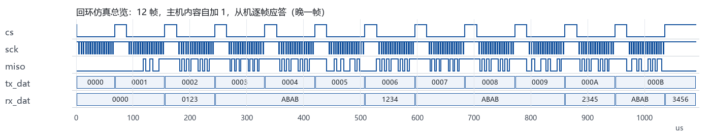
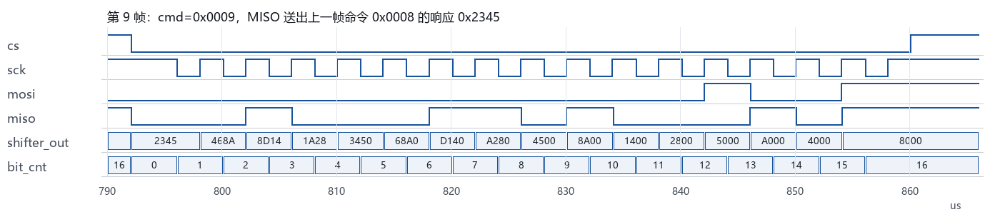
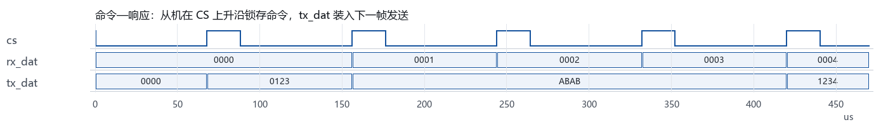

# 零基础教程：按课件做完 SPI 主从通信

> 会 C 语言就能跟下来。全流程就三步：**写从机（Verilog）→ 写主机（C）→ 仿真验证**。
> 三个工具的分工：Quartus 管 CPLD，Keil 管 STM32，ModelSim 只做仿真。

---

## 一、先跑一遍仿真，看看要做成什么样

双击 `exp3\sim\run_sim.bat`：

```text
frame  0 : cmd=0000   slave_rx=0000   master_rx=0000
frame  1 : cmd=0001   slave_rx=0001   master_rx=0123
frame  2 : cmd=0002   slave_rx=0002   master_rx=abab
frame  3 : cmd=0003   slave_rx=0003   master_rx=abab
frame  4 : cmd=0004   slave_rx=0004   master_rx=abab
frame  5 : cmd=0005   slave_rx=0005   master_rx=1234
frame  6 : cmd=0006   slave_rx=0006   master_rx=abab
frame  7 : cmd=0007   slave_rx=0007   master_rx=abab
frame  8 : cmd=0008   slave_rx=0008   master_rx=abab
frame  9 : cmd=0009   slave_rx=0009   master_rx=2345
frame 10 : cmd=000a   slave_rx=000a   master_rx=abab
frame 11 : cmd=000b   slave_rx=000b   master_rx=3456
```

- `cmd`：主机这一帧发的内容，每帧自加 1；
- `slave_rx`：从机收到的，必须等于 `cmd`；
- `master_rx`：主机收回来的，是从机对**上一条**命令的应答。

第 1 帧收到 `0123`（命令 `0000` 的答案），第 5 帧收到 `1234`（命令 `0004` 的答案）……这就是课件里“从机收到 0、4、8、a 时返回不同数据”。

要看波形就双击 `run_gui.bat`。

---

## 二、从机：`rtl/spi_slave.v`

### 2.1 三个问题想清楚就够了

1. **SCK/CS 是异步信号，不能当时钟用。** 用 50 MHz 去采样它，采到“上一拍和这一拍不一样”就是来了边沿。
2. **收和发都在 SCK 的边沿上。** 下降沿收 MOSI，上升沿把输出移位寄存器左移一位（MISO 就自动换下一位）。
3. **CS 上升沿才知道这帧收完了。** 这时锁存命令，并用 `case` 决定下一帧回什么。

### 2.2 边沿检测：打一拍就够了

```verilog
reg cs_tmp = 1'b1, sck_tmp = 1'b1;

always @(posedge clk) begin
    cs_tmp  <= cs;
    sck_tmp <= sck;
end

wire cs_fall  =  cs_tmp & ~cs;      // 上一拍是 1、这一拍是 0 → 下降沿
wire cs_rise  = ~cs_tmp &  cs;
wire sck_fall =  sck_tmp & ~sck;
wire sck_rise = ~sck_tmp &  sck;
```

`<=` 赋值下一拍才生效，所以 `cs_tmp` 里存的就是**上一拍**的 `cs`。把它和当前的 `cs` 做位运算，得到的就是 1 个时钟宽（20 ns）的脉冲——一个真实边沿只会被响应一次。

### 2.3 收发移位寄存器

```verilog
if (cs_fall) begin
    shifter_in  <= 16'h0000;
    shifter_out <= tx_dat;                      // 装上上一帧算好的响应
    bit_cnt     <= 5'd0;
end
else begin
    if (sck_fall && bit_cnt < 16) begin
        shifter_in <= {shifter_in[14:0], mosi}; // 收一位到最低位
        bit_cnt    <= bit_cnt + 1'b1;
    end
    if (sck_rise && bit_cnt < 16) begin
        shifter_out <= {shifter_out[14:0], 1'b0}; // 左移，最高位就是 MISO
    end
end
```

`{a, b}` 是拼接：`{shifter_in[14:0], mosi}` 就是“整体左移一位，个位补新来的 bit”。

`miso` 不用额外逻辑，直接接最高位：

```verilog
assign miso = shifter_out[15];
```

### 2.4 查表应答

```verilog
if (cs_rise) begin
    rx_dat <= shifter_in;                       // 锁存这一帧收到的命令
    case (shifter_in)
        16'h0000: tx_dat <= 16'h0123;
        16'h0004: tx_dat <= 16'h1234;
        16'h0008: tx_dat <= 16'h2345;
        16'h000A: tx_dat <= 16'h3456;
        default : tx_dat <= 16'hABAB;
    endcase
end
```

**为什么用 `shifter_in` 而不是 `rx_dat`**：`rx_dat <= shifter_in` 要等这一拍结束才生效，同一拍读 `rx_dat` 拿到的是旧值，响应就会再多晚一帧。

### 2.5 为什么没有复位

MAX II 的寄存器上电为 0，代码里又给了初值（`reg [15:0] shifter_out = 16'h0000;`），所以上电就能工作，省一个复位引脚。ModelSim 也从 0 开始，不会出现 `X`。

### 2.6 在 Quartus 里建工程、烧进 CPLD

1. `File → Open Project`，选 `exp3\cpld\Exp3_CPLD_Slave.qpf`（现成的，直接能编译）；
2. 若要自己新建：`File → New Project Wizard`，工程名 `Exp3_CPLD_Slave`，**顶层实体名必须写 `spi_slave`**（和 .v 里的 module 名一致），器件族选 `MAX II`、器件选 `EPM240T100C5`，再把 `rtl\spi_slave.v` 加进工程；
3. `Assignments → Pin Planner` 填引脚：

   | 信号 | 引脚 |
   | --- | --- |
   | `clk` | `PIN_12`（50 MHz 晶振，按自己板子核对） |
   | `cs` | `PIN_61` |
   | `sck` | `PIN_57` |
   | `mosi` | `PIN_55` |
   | `miso` | `PIN_53` |

4. `Processing → Start Compilation`（Ctrl+L）。本设计占 **57/240 个逻辑单元（24%）**，50 MHz 下 setup 裕量 +10.3 ns；
5. `Tools → Programmer` → Hardware 选 USB-Blaster → Mode 选 JTAG → `Add File` 选 `output_files\Exp3_CPLD_Slave.pof` → `Start`。

> `clk` 一定要核对：不同开发板晶振接的脚不一样。板上如果只有 25 MHz 也能用，逻辑与频率无关。

---

## 三、主机：`master_stm32/`

### 3.1 打开工程、编译

Keil 里 `Project → Open Project` 选 `exp3\master_stm32\Exp3_SPI.uvprojx`，按 `F7` 编译，应该是 `0 Error(s), 0 Warning(s)`。

工程里只有 4 个需要看的文件：`SPI.h`、`SPI.c`、`main.c`，其余是标准库。

### 3.2 `SPI.h`：把引脚写成宏

```c
#define SPI_CS_PORT   GPIOC
#define SPI_CS_PIN    GPIO_Pin_13

#define SPI_CS_H()    GPIO_SetBits(SPI_CS_PORT,   SPI_CS_PIN)
#define SPI_CS_L()    GPIO_ResetBits(SPI_CS_PORT, SPI_CS_PIN)
#define SPI_MISO      GPIO_ReadInputDataBit(SPI_MISO_PORT, SPI_MISO_PIN)

#define SPI_DELAY_US  2          /* 半周期 2us，SCK 约 200kHz */
```

换板子只改这个文件，`SPI.c` 和 `main.c` 一个字都不用动。

### 3.3 `SPI.c`：引脚初始化 + 收发一帧

引脚初始化就是普通的 GPIO 配置：CS/SCK/MOSI 推挽输出、MISO 上拉输入，最后把 CS、SCK 置高（空闲电平）。

收发一帧：

```c
SPI_CS_L();                     /* 帧开始 */
delay_us(SPI_DELAY_US);         /* 等从机把输出移位寄存器装好 */

for (i = 0; i < 16; i++) {
    if (tx_dat & 0x8000) SPI_MOSI_H(); else SPI_MOSI_L();  /* ① 摆数据 */
    tx_dat <<= 1;
    delay_us(SPI_DELAY_US);

    SPI_SCK_L();                                            /* ② 下降沿 */
    rx_dat = (rx_dat << 1) | SPI_MISO;                      /* ③ 采样 */
    delay_us(SPI_DELAY_US);

    SPI_SCK_H();                                            /* ④ 上升沿 */
}

delay_us(SPI_DELAY_US);
SPI_CS_H();                     /* 帧结束，从机在上升沿锁存命令 */
delay_us(SPI_GAP_US);
```

顺序不能换，尤其 ① 必须在 ② 之前半个周期——从机检测下降沿比主机真正拉低晚 40 ns，数据要是和边沿同时变，采到的就是下一位了。

### 3.4 `main.c`：输出字符

```c
const u16 CHAR_TAB[] = { 0x0000, 0x0004, 0x0008, 0x000A, 0x0055, 0x00AA };

while (1) {
    g_tx = CHAR_TAB[i];
    g_rx = SPI_WriteRead(g_tx);     /* 发一个字符，同时收回响应 */
    i = (i + 1) % 6;
    delay_ms(200);
}
```

`g_tx`、`g_rx` 是全局变量，就是为了在调试器里看。

### 3.5 下载与观察

1. `Options for Target → Debug` 选 `CMSIS-DAP Debugger`（DAPlink），`Settings → Flash Download` 勾 `Reset and Run`；
2. `Flash → Download`（F8）；
3. 按 `Ctrl+F5` 进调试，把 `g_tx`、`g_rx` 加到 Watch 窗口，`Run`：
   - `g_tx` 每 200 ms 变一次：`0000 → 0004 → 0008 → 000A → 0055 → 00AA`；
   - `g_rx` 是上一条字符的答案：`0000` 的答案是 `0123`，`0004` 的答案是 `1234`……
   - 如果 `g_rx` 一直是 `FFFF`，先查 MISO 线和共地。

> PC13 同时是板上的 LED2（低电平亮），而它就是 `CS`，所以传输时 LED2 会闪，正常现象。
> PC13~PC15 是后备域引脚，驱动能力弱（2 MHz），SCK 别再往上飙。

---

## 四、仿真：三个文件

| 文件 | 作用 |
| --- | --- |
| `tb/spi_master.v` | 主机模型：时序和 `SPI.c` 一样，用 `#` 延时写，内容每帧自加 1 |
| `tb/spi_top.v` | 顶层：把主机模型的 `cs/sck/mosi` 接到从机，把 `miso` 接回来 |
| `tb/tb_spi_top.v` | 给 50 MHz 时钟，跑 12 帧，每帧打印一行 |

主机模型的核心就这几行（和 C 一一对应）：

```verilog
cs = 1'b0;              #(HALF_NS);      // 对应 SPI_CS_L(); delay_us(2);
for (i = 0; i < 16; i = i + 1) begin
    mosi = cmd_now[15 - i];  #(HALF_NS); // ① 摆数据
    sck = 1'b0;                          // ② 下降沿
    rx_sh = {rx_sh[14:0], miso};         // ③ 采样
    #(HALF_NS);
    sck = 1'b1;                          // ④ 上升沿
end
cs = 1'b1;
```

**为什么不能直接用 STM32 仿真**：ModelSim 只认 Verilog，仿不了 C。但我们要验证的是从机，所以只要主机的时序“照抄”，仿真通过就等于上板通过。

跑的方式：

```text
exp3\sim\run_sim.bat     命令行，屏幕上看结果
exp3\sim\run_gui.bat     图形界面，看波形
```

手工命令（在 `exp3/sim` 下）：

```bat
vlib work
vmap work work
vlog -work work ..\rtl\spi_slave.v ..\tb\spi_master.v ..\tb\spi_top.v ..\tb\tb_spi_top.v
vsim -c work.tb_spi_top -do "run -all; quit -f"
```

---

## 五、波形怎么读

看波形先看总线（现象），再看模块内部（原因）。`do spi_wave.do` 已经按这个顺序分好组。

### 5.1 总览：12 帧，内容自加 1



- `cs` 12 次低电平，每次 68 µs；
- `tx_dat` 从 `0000` 一路加到 `000B`；
- `rx_dat` 依次 `0000 → 0123 → ABAB … 1234 … 2345 … 3456`，每段都比 `tx_dat` 慢一帧；
- `miso` 上的波形就是这些响应值一位一位发出来的样子。

### 5.2 一帧 16 位



以第 9 帧（`cmd=0009`）为例：

1. `cs` 拉低后先空半个周期才出现第一个 SCK 下降沿——这半周期是留给从机装载 `shifter_out` 的；
2. 低电平期间 `sck` 正好 16 个周期；
3. `mosi` 上是 `0009` 的位序（`0000 0000 0000 1001`，只有最后两位里有 1，所以波形上只有帧尾有两处高电平）；
4. `miso` 上是上一帧命令 `0008` 的响应 `0x2345`（`0010 0011 0100 0101`）；
5. `shifter_out` 每个上升沿左移一位：`2345 → 468A → 8D14 → 1A28 → … → 8000`，可以拿计算器验一下 `0x2345 << 1 = 0x468A`；
6. `bit_cnt` 从 0 数到 16（16 表示已收满），`cs` 上升时清 0。

### 5.3 命令与响应



`rx_dat` 在 `cs` 上升沿变成刚收到的命令；同一个沿上 `tx_dat` 换成这条命令的答案，等下一帧 `cs` 拉低时才装进 `shifter_out` 发出去。所以屏幕上看到的永远是“上一条命令的答案”——这是协议决定的，不是错。

### 5.4 用波形回答问题

| 问题 | 看什么 | 结论 |
| --- | --- | --- |
| 主机按协议发了吗 | `cs` 低 68 µs、期间 16 个 `sck`、`mosi` 在 `sck` 高电平期间变化 | 时序正确，16 位、MSB first |
| 从机收对了吗 | `slave_rx` 逐帧等于 `cmd`，`bit_cnt` 每帧数到 16 | 16 位完整接收，无丢位错位 |
| 主机收对了吗 | `master_rx` 依次出现 `0123/1234/2345/3456/ABAB` | 响应表正确 |
| 为什么晚一帧 | `rx_dat` 变的同时 `tx_dat` 才更新 | 固定一帧流水线延迟 |

---

## 六、上板不通常见原因

| 现象 | 检查 |
| --- | --- |
| `g_rx` 恒 `FFFF` | MISO（IO53↔PA0）没接；CPLD 没供电；两块板没共地 |
| `g_rx` 恒 `0000` | `CS`/`SCK` 没到从机；MISO 被拉低 |
| 偶尔不对 | SCK 太快或线太长，把 `SPI_DELAY_US` 改成 5 试试 |
| 数值和表不符 | `spi_slave.v` 的 `case` 和 `SPI.c` 的期望值不一致 |
| CS 上没有波形 | STM32 没跑起来，先烧个点灯程序确认板子正常 |
| CPLD 烧完无反应 | 引脚分配错 / `clk` 引脚选错，看 Quartus 的 `Pin-Out File` |

用示波器抓：一个通道 `CS`（下降沿触发），另三个看 `SCK/MOSI/MISO`。形状应该和第五节仿真图一致。

---

## 七、常见问题

**Q1：从机为什么要打一拍才能检测边沿？**
`SCK`、`CS` 是主机用 GPIO 拉出来的，相对 50 MHz 时钟是异步的；打一拍既把边沿变成 20 ns 的脉冲，也让可能的亚稳态有时间恢复。

**Q2：`case` 里为什么判断 `shifter_in`，不判断 `rx_dat`？**
`rx_dat <= shifter_in` 这一拍还没生效，读 `rx_dat` 是旧值，响应会再晚一帧。

**Q3：`bit_cnt < 16` 这个条件能去掉吗？**
不能。第 16 个下降沿已经收满，后面可能还有多余的时钟边沿（比如主机多打一拍），会把数据挤掉。

**Q4：MISO 什么时候开始有效？**
`CS` 一拉低，`shifter_out` 就装好了，`MISO` 立刻是响应的最高位，半个周期后第一个下降沿被主机采走，建立时间很充裕。

**Q5：从机没有复位，上电会不会乱？**
不会。MAX II 的寄存器上电为 0，代码里又写了初值，和 ASIC/FPGA 的“上电清零”一致；ModelSim 也从 0 开始。

**Q6：能不能不加 `delay_us`，跑快一点？**
可以，改 `SPI_DELAY_US`。但 PC13~PC15 只能到 2 MHz，实际别超过 500 kHz；想更快就换到 PB 口。

**Q7：`vsim-8891` 警告要紧吗？**
不要紧，只是提示关了优化，仿真会慢一点，换来的是内部信号都能看。

**Q8：`exp3.mpf` 换电脑打不开？**
ModelSim 会写绝对路径，运行 `sim\make_project.bat` 重新生成相对路径版本。

---

## 八、速查

| 要做的事 | 命令 / 位置 |
| --- | --- |
| 编 STM32 | Keil 打开 `master_stm32\Exp3_SPI.uvprojx`，`F7` |
| 烧 STM32 | `F8`（Flash Download） |
| 编 CPLD | Quartus 打开 `cpld\Exp3_CPLD_Slave.qpf`，`Ctrl+L` |
| 烧 CPLD | `Tools → Programmer`，JTAG，`.pof` |
| 跑仿真 | `sim\run_sim.bat` / `sim\run_gui.bat` |
| 看波形 | 图形界面里 `do spi_wave.do` + `run -all` |
| 关键数字 | 16 位一帧、半周期 2 µs、帧低 68 µs、帧间 20 µs、57/240 个 LE |
